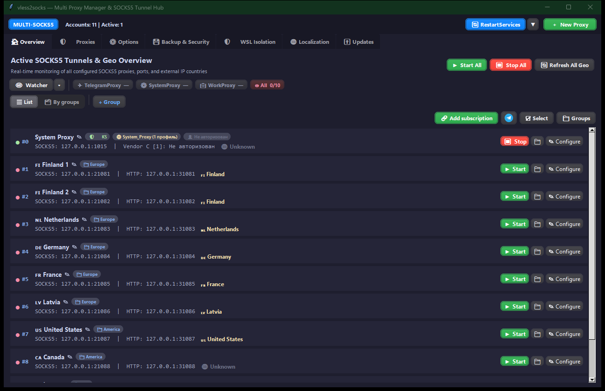
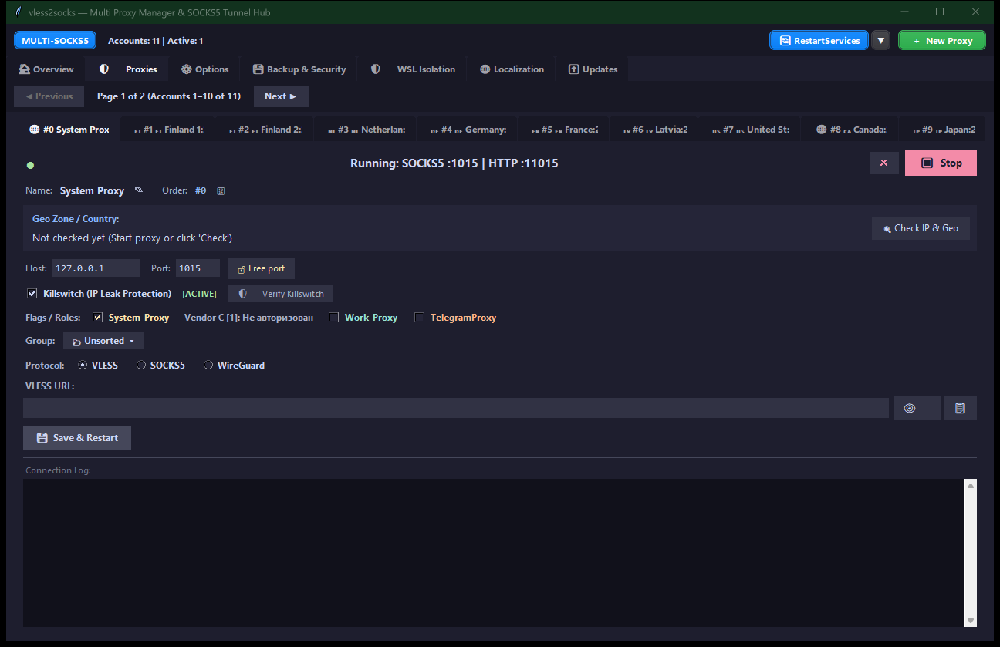
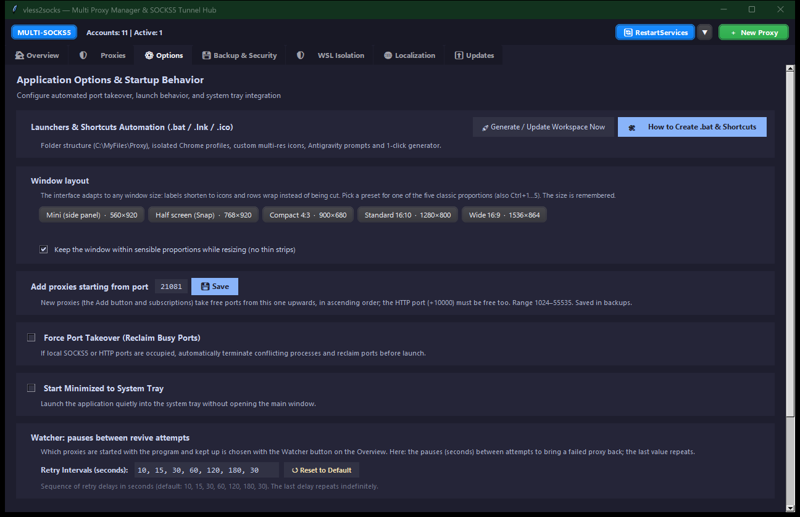
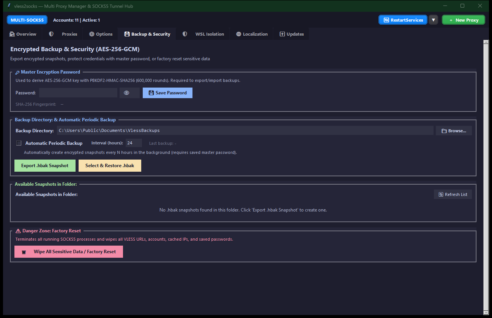
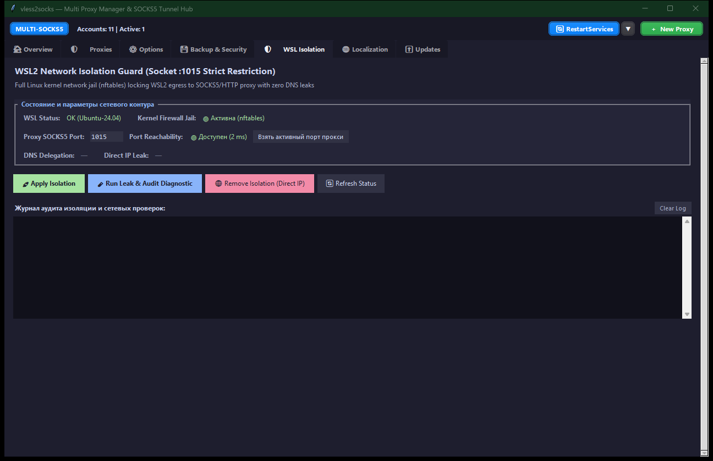
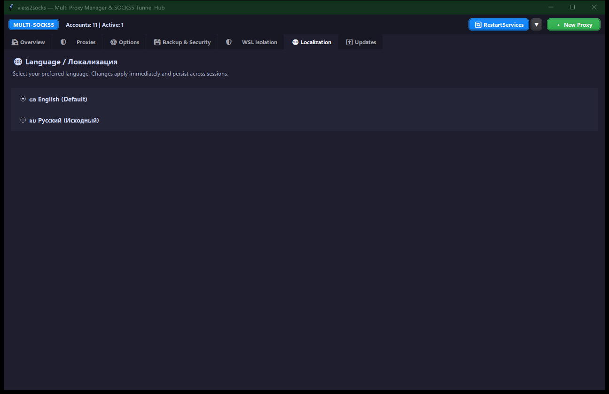
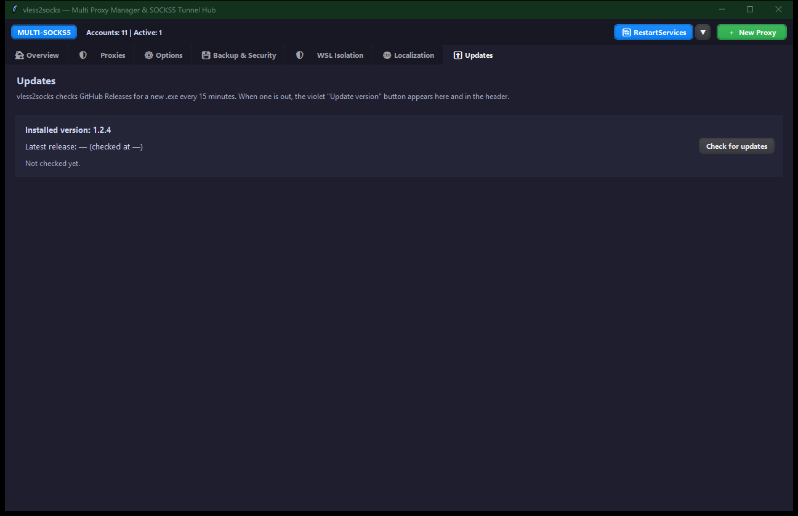

<p align="center">
  
  
  
  
  
  
</p>

<h1 align="center">vless2socks</h1>

<p align="center">
  <b>Multi-Proxy SOCKS5 Manager & VLESS Tunnel Hub for Windows</b><br>
  <sub>Professional GUI for managing unlimited SOCKS5 proxies over VLESS (TCP/TLS/REALITY) with Xray-core backend</sub>
</p>

<p align="center">
  
</p>

---

<!-- ENGLISH SECTION -->
# 🇬🇧 English

## What is vless2socks?

**vless2socks** is a Windows desktop application that converts VLESS proxy links into local SOCKS5 endpoints. It provides a professional Tkinter-based GUI for managing multiple proxy instances simultaneously — with real-time health monitoring, geo-IP country detection, AES-256-GCM encrypted backups, and full bilingual (EN/RU) localization.

### Key Capabilities

| Feature | Description |
|---------|-------------|
| **Multi-Proxy Management** | Unlimited SOCKS5 proxy instances with 10-per-page pagination |
| **TelegramProxy Virtual Socket** | Dedicated virtual hub on `127.0.0.1:1373` (customizable) with master key, seamless failover & auto-rotation across flagged proxies |
| **Watcher** | One service that starts the chosen proxies with the program and brings them back up when they fail: All, TelegramProxy / SystemProxy flags or groups, with status pills |
| **Dual Backend Engine** | Pure Python SOCKS5 server or Xray-core (auto-detected) |
| **Geo-IP Detection** | Country detection from URL fragments + live exit IP lookup via SOCKS5 |
| **Hidden VLESS URLs** | Eye toggle (👁️ / 🙈) to show/hide sensitive VLESS links |
| **Encrypted Backups** | AES-256-GCM with PBKDF2 key derivation, `.hbak` format |
| **Auto-Reconnect** | Configurable retry intervals with exponential backoff |
| **Proxy Launcher Automation** | Auto-generates multi-resolution `.ico` icons, `.bat` runners, and `.lnk` shortcuts with `C:\MyFiles\Proxy` hierarchy |
| **Force Port Takeover** | Automatically kill processes occupying required ports |
| **System Tray** | Minimize to tray with status indicator icons |
| **Bilingual UI** | English (default) and Russian with instant hot-switch |
| **WSL2 Isolation Guard** | Full Linux kernel network jail (nftables) locking WSL2 egress to SOCKS5 :1015 with remote DNS |
| **Factory Reset** | One-click wipe of all proxies, configs, and credentials |

## Installation

### Prerequisites

- **Windows 10/11** (x64)
- **Python 3.10+** with pip
- **Xray-core** binary (auto-downloaded on first run, or place manually in `bin/`)

### Quick Start

```powershell
git clone https://github.com/captainmaclay/vless2socks.git
cd vless2socks
.\install.bat
.\start.bat
```

`install.bat` sets up `.venv`, installs the dependencies, downloads Xray-core and
seeds the config templates; `start.bat` launches the GUI. Double-clicking either
file in Explorer does the same thing.

> The `.\` prefix is required in PowerShell, which does not run programs from the
> current directory. In `cmd.exe` plain `install.bat` works too.

`install.bat` is idempotent — re-running it only fills in what is missing.
`start.bat` calls it by itself when `.venv` is absent, so a fresh clone needs
nothing but `start.bat`.

<details>
<summary>Manual setup, step by step</summary>

```powershell
python -m venv .venv
.venv\Scripts\Activate.ps1          # in cmd.exe: .venv\Scripts\activate.bat
pip install -r requirements.txt
python -m tools.get_xray
.\gui.bat
```
</details>

### Alternative: CLI Mode

```bash
# Single proxy from config file
python main.py -c config.json

# Single proxy from URL
python main.py --url "vless://UUID@host:443?security=tls&type=tcp&sni=host" -l 127.0.0.1:1080

# Run diagnostics
python main.py -c config.json --doctor

# Check tunnel
python main.py -c config.json --test

# Compare direct vs. tunnel IP
python main.py -c config.json --ip
```

## Building a Windows .exe

```powershell
.\build.bat
```

Creates `.venv`, installs the dependencies and PyInstaller if they are missing,
then builds **two** executables from `vless2socks.spec`:

```
dist/
├── vless2socks.exe        # GUI (windowed)
├── vless2socks-cli.exe    # console worker — one process per running proxy
└── bin/
    ├── xray.exe
    ├── geoip.dat
    └── geosite.dat
```

Both executables are required: the GUI runs every proxy as a separate process,
and a frozen build has no `python.exe` or `main.py` on disk to call.

`bin/` is optional. Xray-core deliberately stays **outside** the exe — baking
65 MB into a onefile build would re-extract it to a temp folder on every launch —
and the app downloads it into `bin/` by itself the first time a profile needs it
(REALITY, XTLS or WebSocket). `build.bat` copies an existing `bin/` next to the
exe if you have one, so the release can ship with or without it.

`config.json`, `instances.json` and `settings.json` are created automatically on
first run from templates bundled inside the exe, so `dist/` ships as-is.

## GUI Overview

The application has **7 main tabs**. Screenshots show the current version with demo data (fictional `*.example.net` servers).

### 🏠 Overview


Real-time dashboard showing all configured SOCKS5 proxies with their status, ports, country flags, and quick actions:
- Start/Stop All buttons and Refresh Geo for batch operations.
- **Copy TG_socks** quick button on any proxy instance flagged with `TelegramProxy`.
- **RestartServices Widget** with live health status indicator and slide-down context menu showing the active TelegramProxy upstream socket (`TelegramProxy ({active_socket})`).

### 🛡️ Proxies


Paginated proxy management (10 per page). Each proxy card includes:
- VLESS URL field (hidden by default with 👁️ toggle)
- Host / Port configuration with auto-free-port finder
- **TelegramProxy Flag** — enrolls this proxy in the resilient TelegramProxy virtual rotation pool
- **Copy TG Proxy / TG_socks** button to copy universal Telegram master links
- Start / Stop toggle with real-time health indicator (●)
- Live log viewer with auto-scroll
- Geo-IP country card with refresh button
- SOCKS5 authentication (username/password)
- Backend engine selection (Auto / Python / Xray)

### ⚙️ Options


Persistent settings saved to `settings.json`:
- **Force Port Takeover** — kill processes occupying required ports (default: ON)
- **Auto-Start Proxies on Launch** — start all proxies when app opens (default: ON)
- **Start Minimized to Tray** — launch directly to system tray (default: OFF)
- **Auto-Reconnect on Failure** — automatic retry with configurable intervals (default: ON)
  - Default cycle: `10s → 15s → 30s → 1m → 2m → 3m → 30s (repeat)`
- **TelegramProxy Virtual Port** — customizable listening port for the Telegram relay virtual socket (default: `1373`, with "Reset to 1373" button)

### 💾 Backup & Security


- **Master Password** with SHA-256 fingerprint display
- **Create Encrypted Backup** — exports `.hbak` file (AES-256-GCM)
- **Restore from Backup** — decrypt and restore all configurations
- **Backup Directory** — configurable folder with auto-scan of available snapshots
- **Auto-Backup** — periodic background backups with configurable interval
- **Factory Reset** — wipe all instances, configs, and credentials

### 🛡️ WSL Isolation (WSL2 Network Isolation Guard)


- **Kernel Firewall Jail:** Strict lockdown of WSL2 outbound traffic using `nftables` (with `iptables` fallback) — permits loopback (`lo`, `loopback0`) and rejects direct WAN/LAN connections (`counter reject`).
- **Bypass Defense:** Explicitly drops bypass attempts to unauthorized local ports (e.g. `2080`).
- **DNS Leak Protection:** Automatically configures `ALL_PROXY='socks5h://127.0.0.1:1015'` in `/etc/profile.d/` for remote DNS resolution (Zero DNS leaks).
- **Live Audit & Diagnostics:** One-click streaming verification modal testing port handshake, kernel rules, direct IP leakage, and external IP routing.
- **Proxy Port Selector:** Ability to lock WSL2 to port `1015` or any active SOCKS5 proxy running in vless2socks.
- **Guaranteed Windows Direct IP:** Removes Windows Firewall interference so host tools (`node.exe`, browsers) retain direct internet.

### 🌐 Localization


Switch between English and Russian with one click. All labels, buttons, and messages update instantly without restart.

### ⬆ Updates


Shows the installed version and checks GitHub Releases for a new `.exe` every 15 minutes (or on demand via **Check for updates**). When a release is out, a violet **Update version** button appears here and in the header.

## Configuration Files

| File | Purpose |
|------|---------|
| `config.json` | Single-instance CLI config (created by `--init-config`) |
| `instances.json` | Multi-proxy GUI config (array of proxy objects) |
| `settings.json` | App preferences (language, options, backup settings) |
| `.env` | Master backup password storage |
| `config.example.json` | Template with placeholder values |

## Project Structure

```
vless2socks/
├── main.py                 # CLI entry point
├── gui.py                  # GUI application (VlessApp + ProxyInstance)
├── install.bat             # One-click setup: .venv, deps, Xray-core
├── start.bat               # One-click launch (runs install.bat if needed)
├── gui.bat                 # GUI launcher script
├── build.bat               # Release build: both .exe + xray-core
├── vless2socks.spec        # PyInstaller spec (GUI + CLI targets)
├── tray_widget.py          # Standalone system tray widget
├── i18n.py                 # Bilingual translations (EN/RU)
├── settings_manager.py     # Persistent settings (settings.json)
├── backup_manager.py       # AES-256-GCM encrypted backup system
├── geo_ip.py               # Country detection & live geo lookup
├── requirements.txt        # Python dependencies
├── config.example.json     # Config template
├── run.bat                 # CLI launcher
├── check.bat               # Tunnel check launcher
├── checkip.bat             # IP comparison launcher
├── doctor.bat              # Diagnostics launcher
├── selftest.bat            # Self-test launcher
├── get_xray.bat            # Xray-core downloader
├── tray.bat                # Tray widget launcher
│
├── vless2socks/            # Core library package
│   ├── __init__.py
│   ├── paths.py            # App directories (script / frozen .exe)
│   ├── config.py           # Configuration parser & AppConfig
│   ├── url.py              # VLESS URL parser
│   ├── backend.py          # Backend engine resolver (Python / Xray)
│   ├── socks5.py           # Pure Python SOCKS5 server
│   ├── socks_client.py     # SOCKS5 client for testing
│   ├── protocol.py         # VLESS protocol implementation
│   ├── vless.py            # VLESS connection handler
│   ├── transport.py        # TLS/TCP transport layer
│   ├── relay.py            # Bidirectional data relay
│   ├── doctor.py           # Step-by-step diagnostics
│   ├── selftest.py         # Tunnel connectivity test
│   ├── ipcheck.py          # Direct vs. tunnel IP comparison
│   ├── logging_setup.py    # Console logging configuration
│   ├── telegram_proxy.py   # TelegramProxy virtual socket hub (1373) & seamless failover
│   ├── ink/                # Proxy launcher & multi-resolution icon engine
│   │   ├── colors.py       # HSV color transformations & white shield preservation
│   │   ├── icon_engine.py  # Win32 PE multi-resolution icon extraction (.ico)
│   │   ├── launchers.py    # Bat runner generator (Chrome, Xshell, etc.)
│   │   ├── pipeline.py     # End-to-end launcher & shortcut build pipeline
│   │   └── shortcuts.py    # Windows shell link (.lnk) creator
│   └── xray/               # Xray-core integration
│       ├── __init__.py
│       ├── binary.py       # Xray binary discovery
│       ├── config_builder.py # Xray JSON config generator
│       └── runner.py       # Xray process manager
│
├── proxy_watcher.py       # Watcher: which proxies start with the program and are kept up
│   ├── __init__.py
│   ├── core.py             # Watcher core, state machine & backoff scheduler
│   ├── watcher.py          # Background monitor thread & process checker
│   └── widget.py           # Slide-down RestartServices dropdown widget & minimizer
│
├── tools/                  # Utilities
│   ├── get_xray.py         # Xray-core auto-downloader
│   └── selftest_all.py     # Comprehensive self-test suite
│
├── tests/                  # Unit tests
│   ├── test_features.py
│   └── test_telegram_proxy_dispatcher.py
│
├── wsl-proxy-isolation/    # WSL2 Fail-Safe Network Isolation & Gemini Skills
│   ├── __init__.py
│   ├── wsl_detector.py     # WSL installation & distribution detector
│   ├── firewall_isolate.py # nftables/iptables kernel lockdown engine
│   ├── isolation_tester.py # Multi-stage leak audit & verification suite
│   ├── cli.py              # CLI tool for agents & automation
│   ├── test_isolation_tool.py # Unit test suite
│   ├── README.md           # Standalone isolation documentation
│   └── SKILL.md            # Gemini / Antigravity Agent Skill definition
│
├── bin/                    # Xray-core binary (auto-downloaded)
└── runtime/                # Runtime data
```

## Dependencies

```
cryptography>=41.0.0    # AES-256-GCM encryption for backups
pystray>=0.19.5         # System tray icon
Pillow>=10.0.0          # Tray icon image generation
```

Python standard library modules used: `tkinter`, `asyncio`, `subprocess`, `socket`, `json`, `threading`, `hashlib`, `zipfile`, `io`, `time`, `pathlib`, `argparse`, `signal`, `os`, `sys`, `re`, `urllib.parse`.

## Encryption Details

| Parameter | Value |
|-----------|-------|
| Algorithm | AES-256-GCM (Authenticated Encryption) |
| Key Derivation | PBKDF2-HMAC-SHA256 |
| Salt | 16 bytes (random) |
| Nonce | 12 bytes (random) |
| Key Length | 256 bits |
| PBKDF2 Iterations | 600,000 |
| File Format | `.hbak` with `HBAK\x01` magic header |
| Contents | ZIP archive (instances.json, config.json, settings.json, .env) |

## ✈️ TelegramProxy Virtual Socket & Resilient Failover

vless2socks features a resilient virtual socket dispatcher dedicated to Telegram desktop and mobile clients. Instead of binding Telegram directly to volatile upstream ports, vless2socks provides a single, high-availability master hub:

### 1. Dedicated Virtual Socket Hub (`127.0.0.1:1373`)
- By default, the internal dispatcher listens on `127.0.0.1:1373`.
- **Fully Customizable:** The listening port can be adjusted in real time from the **Options** tab in GUI or via `settings_manager` (`"telegram_proxy_port"` in `settings.json`). A one-click **"Reset to 1373"** button restores the default.
- When modified, the dispatcher automatically unbinds and re-establishes the listener on the new port without interrupting background operations.

### 2. Universal Master Key Links
- Generate instant Telegram-compatible links configured with the virtual socket:
  - MTProto format: `tg://proxy?server=127.0.0.1&port=1373&secret=dd648b061090960667e2620c7949495503`
  - SOCKS5 format: `tg://socks?server=127.0.0.1&port=1373`
- Users only need to add this single proxy link to Telegram once. You never need to update Telegram proxy settings again when switching or changing servers.
- Available via the **Copy TG_socks** button on proxy cards in the Overview tab and in the proxy configuration dialog.

### 3. Dynamic Real-Time Failover & Auto-Rotation
- Any proxy instance in vless2socks can be enrolled in the Telegram pool by enabling the **TelegramProxy** checkbox flag.
- The virtual dispatcher continuously routes incoming Telegram connections to the active flagged proxy.
- If the current active upstream server goes down, resets connections, or times out, the dispatcher instantly and seamlessly fails over to the next healthy proxy with the `TelegramProxy` flag in real time.
- If all flagged proxies are unavailable, the socket remains intact and automatically resumes forwarding the moment any enrolled proxy recovers.
- Flag state and custom port configurations are fully persistent across reboots and saved in `.hbak` encrypted backups.

### 4. RestartServices Integration
- The **RestartServices** widget in the GUI toolbar features an interactive slide-down menu with a dedicated `TelegramProxy ({active_socket})` row.
- It dynamically reflects the active upstream proxy endpoint (e.g., `127.0.0.1:1080` or `127.0.0.1:1081`), or displays `undefined` / `не выбрано` when no enrolled proxies are running.
- Allows one-click restart and reconnect of the TelegramProxy virtual relay service directly from the menu.

---

## 👁 Watcher

One service decides which proxies are kept up (it replaces the former Zapret2 Watcher and the separate auto-start / auto-reconnect switches):

- **Watcher button** on the Overview: green when on, gray when off. The attached ▾ arrow opens a menu where you tick what to watch: **All proxies**, the flags **TelegramProxy** and **SystemProxy**, and your **groups**. Ticking a flag or a group unticks All; ticking All clears the rest.
- **Program start:** only the watched proxies are started (nothing when the Watcher is off).
- **Keeping them up:** a watched proxy that goes down (and was not stopped by you) is brought back with growing pauses (Options → Watcher pauses, default `10 → 15 → 30 → 60 → 120 → 180 → 30` s). When TelegramProxy is watched, its dispatcher is kept running too.
- **Status pills** right of the button: TelegramProxy, SystemProxy and every selected group as running/total.

---

## 🚀 Antigravity Agent Skills Suite

vless2socks comes integrated with custom autonomous skills designed for Google DeepMind **Antigravity** and **Gemini AI** coding agents.

### 1. `wsl-proxy-isolation` — Fail-Safe WSL2 Kernel Firewall Jail
- **Location:** `wsl-proxy-isolation/SKILL.md` (and `~/.gemini/config/skills/wsl-proxy-isolation/SKILL.md`)
- **Kernel Lockdown:** Configures strict `nftables` (with `iptables` fallback) rules inside WSL2. Outbound network traffic is locked to the loopback interface (`lo`) and local SOCKS5 port `1015`/`11015`, dropping all direct WAN/LAN connections (`counter reject`).
- **Zero DNS Leaks:** Configures `ALL_PROXY='socks5h://127.0.0.1:1015'` in `/etc/profile.d/` for complete remote domain name resolution.
- **Bypass Protection:** Rejects unauthorized local ports (e.g. `2080`).
- **Automated Verification:** Comprehensive testing pipeline testing TCP handshake latency, direct IP leakage, and proxy routing via CLI:
  ```powershell
  # Check WSL status
  python wsl-proxy-isolation/cli.py check-wsl

  # Apply isolation to port 1015
  python wsl-proxy-isolation/cli.py apply --port 1015

  # Run comprehensive diagnostic audit
  python wsl-proxy-isolation/cli.py test --port 1015

  # Automated pipeline: Check -> Apply -> Audit
  python wsl-proxy-isolation/cli.py full-setup

  # Restore direct IP access
  python wsl-proxy-isolation/cli.py remove
  ```

### 2. `proxy-launcher-generator` — Multi-Resolution Icon & Launcher Automation
- **Location:** `~/.gemini/config/skills/proxy-launcher-generator/SKILL.md` & `vless2socks/ink/`
- **Standardized Proxy Hierarchy:** Automates the creation of isolated launchers and shortcuts inside `C:\MyFiles\Proxy\`:
  ```text
  C:\MyFiles\Proxy\
  ├── Chrome_Socket_1015.bat        # Launcher batch runners in root
  ├── Xshell_Socket_1030.bat
  ├── ico/                          # Multi-resolution application icons
  │   ├── chrome_gold.ico
  │   └── xshell_cyan.ico
  └── ink/                          # Windows shortcuts (.lnk)
      ├── Chrome Socket 1015.lnk
      └── Xshell Socket 1030.lnk
  ```
- **Typo Protection (NTFS Junctions):** Automatically links `link` and `lnk` aliases to `ink`:
  ```cmd
  mklink /J "C:\MyFiles\Proxy\link" "C:\MyFiles\Proxy\ink"
  mklink /J "C:\MyFiles\Proxy\lnk" "C:\MyFiles\Proxy\ink"
  ```
- **PE Multi-Res Extraction:** Extracts genuine 32-bit icon layers (256, 128, 64, 48, 32, 24, 16 px) directly from PE binaries (`chrome.exe`, `Xshell.exe`) using `pefile` (`RT_GROUP_ICON` -> `RT_ICON`) to eliminate Windows 10/11 scaling blur.
- **HSV Badge Preservation:** Accurately tints application icons to custom proxy colors while preserving white dividers, badges, and inner graphics.

### 3. `wsl-gui-troubleshooting` — Linux GUI & Electron Lifecyle in WSLg
- **Location:** `~/.gemini/config/skills/wsl-gui-troubleshooting/SKILL.md`
- **Elimination of Zombie Processes:** Solves the issue where closing an Electron application (e.g., Claude Desktop) in WSL2 fails to terminate the background process due to missing system tray support in WSLg (`kill -TERM`, `chrome_crashpad_handler`).
- **SingletonLock Recovery:** Automatically cleans stale lockfiles (`~/.config/<App>/SingletonLock`) preventing instances from failing silently on relaunch.
- **Session DBus Setup:** Ensures `XDG_RUNTIME_DIR` and `DBus` (`/run/user/<uid>/bus`) are properly started before launching graphical applications.
- **See also:** [`skills/claude_wsl_gui/SKILL.md`](skills/claude_wsl_gui/SKILL.md) — in-repo specification of the Claude Desktop launcher lifecycle, lockfile and WSLg COPY MODE.
### 4. `claude-wsl-gui-manager` — Vendor C Desktop GUI & CLI Environment Isolation (Research & Sandbox)
- **Research Notice:** Developed strictly for research and testing of Linux (WSL2/WSLg) process containerization, Chromium OSCrypt/GNOME Keyring storage, and proxy socket routing.
- **Location:** `~/.gemini/config/skills/claude-wsl-gui-manager/SKILL.md`
- **Toolkit & Scripts:** [`new_claude/`](new_claude/)
- **Step-by-Step Guide:** [`new_claude/howToCreate.md`](new_claude/howToCreate.md) and [`VENDOR_C_ENVIRONMENT_OVERVIEW.md`](VENDOR_C_ENVIRONMENT_OVERVIEW.md)
- **Detailed Subsystem Manuals:** [`VENDOR_C_WSL_GUI_ENVIRONMENTS.md`](VENDOR_C_WSL_GUI_ENVIRONMENTS.md) (Linux / WSLg GUI) and [`VENDOR_C_CLI_ENVIRONMENTS.md`](VENDOR_C_CLI_ENVIRONMENTS.md) (Windows CLI)
- **Key Capabilities:**
  - **Zero Shared State:** Complete filesystem isolation for Vendor C Desktop (`/home/<user>/.claude-<id>/.config/Claude`) and Vendor C CLI (`C:\Users\<user>\.claude-<id>`).
  - **GNOME Keyring & Secret Service Integration:** Provisions passwordless `login.keyring` via `init_wsl_keyring.sh` so no `Unlock Login Keyring` prompt appears; Electron itself runs with `--password-store=basic` (see [`skills/claude_wsl_gui/SKILL.md`](skills/claude_wsl_gui/SKILL.md), Gotcha 8).
  - **Pre-Launch IP Verification & Mac UI Toast:** [`verify_and_notify.py`](new_claude/verify_and_notify.py) checks outbound SOCKS5 IP against target node before launch, showing macOS-styled 4s/5s fadeout toasts.
  - **Automated Provisioning:** One-click deployment of new instances via [`add_vendor_c_gui_instance.py`](new_claude/add_vendor_c_gui_instance.py) and [`add_vendor_c_cli_instance.py`](new_claude/add_vendor_c_cli_instance.py).

### 5. `initial-start` — Autonomous Full-Stack Deployment, WSL2 Hardening & Subagent Workflow
- **Starter Prompt & Guide:** [`0_HowToInstall.txt`](0_HowToInstall.txt)
- **Full Specification:** [`skills/initial_start/SKILL.md`](skills/initial_start/SKILL.md) & [`initial_start.md`](initial_start.md)
- **Subagent Workflow & Orchestrator:** [`WORKFLOW_ORCHESTRATOR.md`](WORKFLOW_ORCHESTRATOR.md) & [`workflow_sequence.json`](workflow_sequence.json)
- **Machine-Readable Trajectory (XML):** [`skills/initial_start/chat_reference.xml`](skills/initial_start/chat_reference.xml)
- **Automation Package:** [`setup_helpers/`](setup_helpers/) (`01` to `08`, [`install_all.ps1`](install_all.ps1))
- **Key Modules & Solved Pitfalls:**
  - Automated build from source (dynamic Git latest release tag resolution), Xray fetch, and `C:\MyFiles\vless2socks` NTFS junction.
  - Mirrored network mode WSL2 setup with non-interactive kernel packages (`nftables`, `iptables`, `curl`).
  - Strict netfilter network jail (`lo`/`loopback0` only, reject WAN/LAN, bypass port 2080 drop).
  - Autonomous boot guard in Windows Task Scheduler (`WSL_AutoIsolation_Guard`) with multi-locale parsing (Russian/English).
  - Multi-profile Vendor C Claude Code CLI (ports 1015 & 1016) with Killswitch (`verify_and_notify.py`) and Windows Credential Manager key isolation (`.claude-1`, `.claude-secondary`).
  - Multi-profile Google Chrome instances with HSV-recolored ICOs and typo-proof junctions (`link/lnk -> ink`).
  - Full perimeter penetration audit yielding **100% ISOLATED** verdict.

### 6. `xshell` — NetSarang Xshell 8 SOCKS5 Integration & Session Cryptography
- **Full Specification:** [`skills/xshell/SKILL.md`](skills/xshell/SKILL.md)
- **Machine-Readable Trajectory (XML):** [`skills/xshell/chat_history.xml`](skills/xshell/chat_history.xml)
- **Automation Package:** [`setup_helpers/xshell/`](setup_helpers/xshell/) & [`setup_helpers/setup_xshell.bat`](setup_helpers/setup_xshell.bat)
- **Key Solutions & Reverse-Engineering:**
  - Circumvention of InstallScript bypass (msiexec raw install error 40004 in `nslicense.dll` RVA 0x3450) and repair of empty `TargetPath` / `SHELL_OBJECT_FOLDER`.
  - Background WinSta0\default desktop isolation handling via `SetThreadDesktop`.
  - UTF-16 LE BOM SOCKS5 proxy INI generation (`Documents\NetSarang Computer\8\Common\Proxy\SOCKS5_<PORT>.ini`) with registry mirror and `default.xshf` template binding.
  - NetSarang v7/v8 ARC4 session password encryption via reverse Username+SID KDF.

### 7. `github_safe_push` — Security Sanitation & Safe GitHub Push Protocol
- **Full Specification:** [`skills/github_safe_push/SKILL.md`](skills/github_safe_push/SKILL.md)
- **Automation Script:** [`setup_helpers/git_safe_push.ps1`](setup_helpers/git_safe_push.ps1)
- **Mandatory Policy (Review Every Push):** Before performing **every push**, agents and developers **must review and update this skill** to verify that no new sensitive files, API tokens, `.env` configs, or private credentials are inadvertently committed.
- **Key Protections:**
  - In-memory credential forwarding preventing token persistence in `.git/config` or shell history.
  - Pre-push automated scanning against prohibited configuration targets (`instances.json`, `config.json`, `.env`, `vendor_c_accounts.json`).
  - Strict preservation of untracked personal session files while deploying all public skills, tests, and setup helpers.

### 8. `wsl_gui_hidpi` — WSLg High-DPI Scaling & Keyring Bypass Protocol
- **Full Specification:** [`skills/wsl_gui_hidpi/SKILL.md`](skills/wsl_gui_hidpi/SKILL.md)
- **Automation Scripts:** [`setup_helpers/09_configure_wsl_hidpi_keyring.ps1`](setup_helpers/09_configure_wsl_hidpi_keyring.ps1) & [`new_claude/configure_wsl_hidpi_keyring.sh`](new_claude/configure_wsl_hidpi_keyring.sh)
- **Key Solutions:**
  - Complete elimination of blocking GNOME Keyring modal dialogs (`Unlock Login Keyring`) by decoupling Electron via `--password-store=basic` and wiping corrupted keystores.
  - High-DPI scaling on 2K/3K/4K displays (3072×1920 @ 192 DPI / 200% scaling) via `%USERPROFILE%\.wslgconfig`, `--force-device-scale-factor=1.0` (Weston already applies 2×; a factor of 2 doubled it to 400%), and `/etc/profile.d/wsl_hidpi.sh`. Current scaling math: [`skills/claude_wsl_gui/SKILL.md`](skills/claude_wsl_gui/SKILL.md).

### 9. `claude_wsl_gui` — Claude Desktop GUI in WSL2/WSLg via vless2socks Sockets
- **Full Specification:** [`skills/claude_wsl_gui/SKILL.md`](skills/claude_wsl_gui/SKILL.md)
- **Toolkit:** [`new_claude/template_claude_gui.sh`](new_claude/template_claude_gui.sh), [`new_claude/template_run_gui.vbs`](new_claude/template_run_gui.vbs), [`new_claude/add_vendor_c_gui_instance.py`](new_claude/add_vendor_c_gui_instance.py), [`new_claude/update_launchers.py`](new_claude/update_launchers.py), [`new_claude/create_desktop_shortcut.ps1`](new_claude/create_desktop_shortcut.ps1), [`new_claude/verify_and_notify.py`](new_claude/verify_and_notify.py)
- **Covers:**
  - Launch chain `.lnk → VBS → verify_and_notify.py pre-flight → wsl.exe → /usr/local/bin/claude-gui-<id>` with per-instance `--proxy-server=socks5://127.0.0.1:<port>` and `ALL_PROXY=socks5h://…`.
  - HiDPI math (Windows 200% × Weston scale 2 × Chromium DIP) and the double-scaling (400%) bugfix.
  - Window geometry persistence (`window-geometry.conf` ⇄ `window-state.json`, `xdotool`/`xprop` polling every 1.5 s).
  - Process lifecycle: close-to-hide zombies, Singleton locks, lockfile against double launch, launch retries, shared DBus bus.
  - WSLg `[WARN:COPY MODE]` (broken shared memory → blank windows): root cause, detection, `wsl --shutdown` self-heal, `instanceIdleTimeout=-1`.
  - Diagnostics runbook; templates (`template_claude_gui.sh`, `template_run_gui.vbs`, `wslg_health.sh`) are the single source of truth, redeployed via `update_launchers.py`.

## License

MIT License. See [LICENSE](LICENSE) for details.

---

<!-- RUSSIAN SECTION -->
# 🇷🇺 Русская документация

## Что такое vless2socks?

**vless2socks** — это десктопное приложение для Windows, которое преобразует VLESS-ссылки в локальные SOCKS5-прокси. Профессиональный GUI на Tkinter для одновременного управления множеством прокси-инстансов — с мониторингом состояния в реальном времени, определением страны по GeoIP, шифрованными бэкапами AES-256-GCM и двуязычным интерфейсом (EN/RU).

### Основные возможности

| Возможность | Описание |
|-------------|----------|
| **Мультипрокси** | Неограниченное количество SOCKS5-прокси с пагинацией по 10 на страницу |
| **TelegramProxy Виртуальный сокет** | Выделенный отказоустойчивый хаб на `127.0.0.1:1373` (настраиваемый) с мастер-ключом и бесшовной ротацией |
| **Watcher** | Единая служба: запускает выбранные прокси при старте программы и поднимает их после падения — «Все», флаги TelegramProxy / SystemProxy или группы, с индикаторами состояния |
| **Двойной движок** | Встроенный Python SOCKS5-сервер или Xray-core (автовыбор) |
| **Geo-IP** | Определение страны из URL-фрагмента + живой запрос внешнего IP через SOCKS5 |
| **Скрытие VLESS-ссылок** | Кнопка-глаз (👁️ / 🙈) для показа/скрытия конфиденциальных ссылок |
| **Шифрованные бэкапы** | AES-256-GCM с PBKDF2, формат `.hbak` |
| **Авто-переподключение** | Настраиваемые интервалы повтора с нарастающей задержкой |
| **Автоматизация лаунчеров** | Создание многослойных `.ico` иконок, `.bat` скриптов и ярлыков `.lnk` с иерархией `C:\MyFiles\Proxy` |
| **Захват портов** | Автоматическое завершение процессов, занимающих нужные порты |
| **Системный трей** | Сворачивание в трей с иконкой-индикатором |
| **Локализация** | Английский (по умолчанию) и русский — мгновенное переключение |
| **Изоляция WSL2** | Сетевая тюрьма ядра Linux (nftables): изоляция WSL2 на SOCKS5 :1015 без утечек DNS |
| **Сброс настроек** | Полная очистка всех прокси, конфигов и учётных данных |

## Установка

### Требования

- **Windows 10/11** (x64)
- **Python 3.10+** с pip
- **Xray-core** (скачивается автоматически при первом запуске или вручную в `bin/`)

### Быстрый старт

```powershell
git clone https://github.com/captainmaclay/vless2socks.git
cd vless2socks
.\install.bat
.\start.bat
```

`install.bat` создаёт `.venv`, ставит зависимости, качает Xray-core и раскладывает
шаблоны конфигов; `start.bat` запускает GUI. Двойной щелчок по этим файлам в
Проводнике делает то же самое.

> Префикс `.\` обязателен в PowerShell — он не запускает программы из текущей
> папки. В `cmd.exe` работает и просто `install.bat`.

`install.bat` можно запускать повторно — он доставляет только то, чего нет.
`start.bat` сам вызовет установку, если `.venv` отсутствует, так что свежему
клону достаточно одного `start.bat`.

<details>
<summary>Установка вручную, по шагам</summary>

```powershell
python -m venv .venv
.venv\Scripts\Activate.ps1          # in cmd.exe: .venv\Scripts\activate.bat
pip install -r requirements.txt
python -m tools.get_xray
.\gui.bat
```
</details>

### Режим командной строки (CLI)

```bash
# Один прокси из config.json
python main.py -c config.json

# Один прокси из VLESS-ссылки
python main.py --url "vless://UUID@host:443?security=tls&type=tcp&sni=host" -l 127.0.0.1:1080

# Диагностика
python main.py -c config.json --doctor

# Проверка туннеля
python main.py -c config.json --test

# Сравнение прямого и туннельного IP
python main.py -c config.json --ip
```

## Сборка .exe под Windows

```powershell
.\build.bat
```

Создаёт `.venv`, доставляет зависимости и PyInstaller, если их нет, и собирает
по `vless2socks.spec` **два** исполняемых файла:

```
dist/
├── vless2socks.exe        # GUI (без консоли)
├── vless2socks-cli.exe    # консольный рабочий процесс — по одному на прокси
└── bin/
    ├── xray.exe
    ├── geoip.dat
    └── geosite.dat
```

Нужны оба exe: GUI поднимает каждый прокси отдельным процессом, а внутри сборки
нет ни `python.exe`, ни `main.py` на диске.

Папка `bin/` необязательна. Xray-core намеренно лежит **снаружи** exe — зашивать
65 МБ в onefile-сборку значит распаковывать их во временную папку при каждом
запуске, — а программа сама скачивает его в `bin/`, когда впервые встречает
профиль, которому он нужен (REALITY, XTLS или WebSocket). `build.bat` скопирует
существующий `bin/` рядом с exe, если он у вас есть, так что релиз можно отдавать
и с ним, и без него.

`config.json`, `instances.json` и `settings.json` создаются сами при первом
запуске из шаблонов, зашитых в exe, — папку `dist/` можно отдавать как есть.

## Вкладки GUI

В приложении **7 основных вкладок**. На скриншотах — текущая версия на демо-данных (вымышленные серверы `*.example.net`).

### 🏠 Обзор (Overview)


Панель мониторинга со всеми настроенными прокси: статус, порты, флаги стран, кнопки управления:
- Групповые операции «Запустить все» / «Остановить все» и «Обновить GeoIP».
- Быстрая кнопка **Copy TG_socks** на карточках прокси, отмеченных флагом `TelegramProxy`.
- Виджет **RestartServices** с живым индикатором состояния и выпадающим меню со строкой активного сокета `TelegramProxy ({активный_сокет})` (или `не выбрано`).

### 🛡️ Прокси (Proxies)


Управление прокси с пагинацией (10 на страницу). Каждая карточка содержит:
- Поле VLESS URL (скрыто по умолчанию, кнопка 👁️)
- Хост / Порт с автоподбором свободного порта
- Флаг **TelegramProxy** — включение прокси в пул отказоустойчивой ротации для Telegram
- Кнопка **Copy TG Proxy / TG_socks** для копирования универсальной мастер-ссылки
- Кнопка Start/Stop с индикатором здоровья (●)
- Живой просмотр логов с автопрокруткой
- Карточка GeoIP с обновлением
- SOCKS5-аутентификация (логин/пароль)
- Выбор движка (Auto / Python / Xray)

### ⚙️ Опции (Options)


Постоянные настройки в `settings.json`:
- **Force Port Takeover** — принудительное освобождение портов (по умолчанию: ВКЛ)
- **Auto-Start Proxies on Launch** — запуск прокси при старте (по умолчанию: ВКЛ)
- **Start Minimized to Tray** — запуск в трее (по умолчанию: ВЫКЛ)
- **Auto-Reconnect on Failure** — автопереподключение (по умолчанию: ВКЛ)
  - Цикл по умолчанию: `10с → 15с → 30с → 1м → 2м → 3м → 30с (повтор)`
- **Порт TelegramProxy** — настраиваемый порт виртуального сокета для Telegram (по умолчанию: `1373`, с кнопкой сброса к 1373)

### 💾 Бэкап и Безопасность (Backup & Security)


- Мастер-пароль с отпечатком SHA-256
- Создание зашифрованного бэкапа `.hbak` (AES-256-GCM)
- Восстановление из бэкапа
- Выбор папки бэкапов с автосканированием доступных снимков
- Авто-бэкап с настраиваемым интервалом (в часах)
- Полный сброс (Factory Reset)

### 🛡️ WSL Изоляция (WSL2 Isolation Guard)


- **Сетевая тюрьма ядра Linux:** Жесткая блокировка исходящего трафика WSL2 через `nftables` (или `iptables`) — разрешен только loopback (`lo`, `loopback0`), весь прямой WAN/LAN трафик отсекается правилом `counter reject`.
- **Защита от обходов:** Блокировка попыток выхода через сторонние сокеты (например, `127.0.0.1:2080`).
- **Удаленный DNS (Zero Leaks):** Автоматическая настройка `ALL_PROXY='socks5h://127.0.0.1:1015'` в `/etc/profile.d/` — доменные имена разрешаются на стороне прокси, исключая утечки хостового DNS.
- **Интерактивный аудит:** Проверка доступности портов, правил фильтрации ядра, теста утечки реального IP и удаленного DNS в реальном времени с цветным журналом.
- **Синхронизация портов:** Привязка к порту `1015` или к любому активному SOCKS5 прокси из vless2socks в один клик.
- **Свобода Windows-хоста:** Автоматическое удаление правил брандмауэра Windows — процессы Windows (`node.exe`, браузеры) сохраняют прямой доступ (Direct IP).

### 🌐 Локализация (Localization)


Переключение между английским и русским одним кликом. Все элементы обновляются мгновенно.

### ⬆ Обновления (Updates)


Показывает установленную версию и каждые 15 минут проверяет GitHub Releases на новый `.exe` (или по кнопке **Check for updates**). Когда релиз вышел, здесь и в шапке появляется фиолетовая кнопка **Update version**.

## Файлы конфигурации

| Файл | Назначение |
|------|-----------|
| `config.json` | Конфиг для одного прокси (CLI) |
| `instances.json` | Все прокси для GUI (массив объектов) |
| `settings.json` | Настройки приложения (язык, опции, бэкапы) |
| `.env` | Хранилище мастер-пароля бэкапов |
| `config.example.json` | Шаблон конфигурации |

## Шифрование

| Параметр | Значение |
|----------|----------|
| Алгоритм | AES-256-GCM (аутентифицированное шифрование) |
| Получение ключа | PBKDF2-HMAC-SHA256 |
| Соль | 16 байт (случайная) |
| Nonce | 12 байт (случайный) |
| Длина ключа | 256 бит |
| Итерации PBKDF2 | 600 000 |
| Формат файла | `.hbak` с магическим заголовком `HBAK\x01` |
| Содержимое | ZIP-архив (instances.json, config.json, settings.json, .env) |

## ✈️ Виртуальный сокет TelegramProxy и отказоустойчивый Failover

В **vless2socks** встроен выделенный диспетчер виртуального сокета специально для клиентов Telegram (Desktop и Mobile). Вместо привязки Telegram к нестабильным портам отдельных серверов, программа предоставляет единый отказоустойчивый хаб:

### 1. Выделенный виртуальный хаб (`127.0.0.1:1373`)
- По умолчанию диспетчер слушает порт `127.0.0.1:1373`.
- **Полная гибкость настройки:** Порт можно изменить в любой момент на вкладке **«Опции»** в GUI или через менеджер настроек (`telegram_proxy_port` в `settings.json`). Кнопка **«Сбросить на 1373»** позволяет мгновенно вернуть порт по умолчанию.
- При смене порта диспетчер на лету переоткрывает локальный сокет без остановки фоновых сервисов.

### 2. Универсальные мастер-ссылки для Telegram
- Генерация ссылок единого формата для мгновенного добавления в Telegram:
  - MTProto-формат: `tg://proxy?server=127.0.0.1&port=1373&secret=dd648b061090960667e2620c7949495503`
  - SOCKS5-формат: `tg://socks?server=127.0.0.1&port=1373`
- Достаточно один раз добавить эту ссылку в Telegram. При смене серверов или падении соединений менять настройки внутри Telegram больше не требуется!
- Ссылку можно скопировать кнопкой **Copy TG_socks** прямо с карточки любого прокси в «Обзоре» или в окне настройки конкретного прокси.

### 3. Бесшовный Failover и динамическая ротация
- Любой прокси в vless2socks можно включить в Telegram-пул, отметив чекбокс **TelegramProxy**.
- Виртуальный диспетчер маршрутизирует входящие соединения Telegram на активный рабочий прокси из пула.
- Если текущий сервер падает, обрывает соединение или не отвечает, диспетчер в реальном времени бесшовно переключает трафик на следующий живой прокси с флагом `TelegramProxy`.
- Если все отмеченные прокси временно недоступны, виртуальный сокет не падает, а возобновляет работу сразу же при восстановлении любого из них.
- Состояние флагов и пользовательский порт надёжно сохраняются в конфигах и восстанавливаются из зашифрованных бэкапов `.hbak`.

### 4. Интеграция с RestartServices
- Виджет **RestartServices** на панели управления оснащен выпадающим меню, где отдельной строкой отображается сокет: `TelegramProxy ({активный_сокет})` (например, `127.0.0.1:1080` или `не выбрано`).
- Позволяет в один клик перезапустить службу виртуального прокси Telegram при возникновении задержек или сбоев.

---

## 👁 Watcher

Одна служба решает, какие прокси поддерживать поднятыми (заменяет прежний Zapret2 Watcher и отдельные переключатели автозапуска и автопереподключения):

- **Кнопка Watcher** на Обзоре: зелёная — включён, серая — выключен. Слитная стрелка ▾ открывает меню, где галочками выбирается, за чем следить: **Все прокси**, флаги **TelegramProxy** и **SystemProxy**, ваши **группы**. Выбор флага или группы снимает «Все»; выбор «Все» снимает остальное.
- **Старт программы:** запускаются только выбранные прокси (при выключенном Watcher — никакие).
- **Подъём после падения:** упавший выбранный прокси (если его не остановили вы) поднимается с нарастающими паузами (Опции → паузы Watcher, по умолчанию `10 → 15 → 30 → 60 → 120 → 180 → 30` с). Если выбран TelegramProxy, Watcher держит запущенным и его диспетчер.
- **Индикаторы** справа от кнопки: TelegramProxy, SystemProxy и каждая выбранная группа — сколько из скольких работает.

---

## 🚀 Набор скиллов для агентов Antigravity / Gemini

Кодовая база vless2socks стандартизирована для взаимодействия с автономными AI-агентами Google DeepMind Antigravity и Gemini с помощью набора специализированных скиллов:

### 1. `wsl-proxy-isolation` — Сетевая тюрьма ядра Linux (WSL2)
- **Расположение:** `wsl-proxy-isolation/SKILL.md` (и `~/.gemini/config/skills/wsl-proxy-isolation/SKILL.md`)
- **Защита ядра Linux:** Настраивает правила `nftables` (с фоллбэком на `iptables`) внутри WSL2. Исходящий трафик заблокирован правилом `counter reject`, за исключением loopback (`lo`) и порта SOCKS5 `1015`/`11015`.
- **Защита от DNS-утечек:** Автоматическая настройка `ALL_PROXY='socks5h://127.0.0.1:1015'` в `/etc/profile.d/` — все DNS-запросы разрешаются удаленно через прокси.
- **Защита от обхода:** Блокировка попыток подключений к неавторизованным локальным сокетам (например, `:2080`).
- **Автоматизированный аудит через CLI:**
  ```powershell
  # Проверка окружения WSL
  python wsl-proxy-isolation/cli.py check-wsl

  # Применение изоляции на порт 1015
  python wsl-proxy-isolation/cli.py apply --port 1015

  # Запуск комплексного аудита утечек
  python wsl-proxy-isolation/cli.py test --port 1015

  # Полный цикл (проверка -> настройка -> аудит)
  python wsl-proxy-isolation/cli.py full-setup

  # Снятие изоляции и возврат прямого выхода в сеть
  python wsl-proxy-isolation/cli.py remove
  ```

### 2. `proxy-launcher-generator` — Автоматизация многослойных иконок и лаунчеров
- **Расположение:** `~/.gemini/config/skills/proxy-launcher-generator/SKILL.md` и модуль `vless2socks/ink/`
- **Иерархия папки лаунчеров:** Автоматизирует создание изолированных скриптов и ярлыков в `C:\MyFiles\Proxy\`:
  ```text
  C:\MyFiles\Proxy\
  ├── Chrome_Socket_1015.bat        # Батники запуска в корне папки
  ├── Xshell_Socket_1030.bat
  ├── ico/                          # Цветные иконки со всеми слоями разрешения
  │   ├── chrome_gold.ico
  │   └── xshell_cyan.ico
  └── ink/                          # Windows-ярлыки (.lnk)
      ├── Chrome Socket 1015.lnk
      └── Xshell Socket 1030.lnk
  ```
- **Защита от опечаток (NTFS Junctions):** Автоматическое создание симлинков-директорий `link` и `lnk` на папку `ink`:
  ```cmd
  mklink /J "C:\MyFiles\Proxy\link" "C:\MyFiles\Proxy\ink"
  mklink /J "C:\MyFiles\Proxy\lnk" "C:\MyFiles\Proxy\ink"
  ```
- **Извлечение системных слоев из PE:** С помощью `pefile` (`RT_GROUP_ICON` -> `RT_ICON`) слои иконок (256, 128, 64, 48, 32, 24, 16 px) достаются прямо из бинарников (`chrome.exe`, `Xshell.exe`), что предотвращает мыло и артефакты масштабирования в Windows 10/11.
- **HSV-трансформация:** Корректно перекрашивает иконки в индивидуальные цвета портов, сохраняя белые системные ободки, бейджи и логотипы.

### 3. `wsl-gui-troubleshooting` — Запуск и отладка Linux GUI в WSLg
- **Расположение:** `~/.gemini/config/skills/wsl-gui-troubleshooting/SKILL.md`
- **Устранение зомби-процессов:** Решает проблему зависания Electron-приложений (например, Claude Desktop) при закрытии крестиком из-за отсутствия системного трея в WSLg (`kill -TERM`, `chrome_crashpad_handler`).
- **Сброс SingletonLock:** Автоматическая очистка блокировок `~/.config/<App>/SingletonLock`, устраняющая сбои повторного запуска.
- **Инициализация сессионного DBus:** Гарантирует запуск `XDG_RUNTIME_DIR` и `dbus-daemon` перед стартом GUI-процессов.
- **См. также:** [`skills/claude_wsl_gui/SKILL.md`](skills/claude_wsl_gui/SKILL.md) — спецификация жизненного цикла лаунчера Claude Desktop, lockfile и WSLg COPY MODE в репозитории.
### 4. `claude-wsl-gui-manager` — Изоляция тестовых сред Вендора C в WSL2/Windows (Исследовательские цели)
- **Примечание об исследовательской направленности:** Модуль и документация созданы исключительно для исследовательских и образовательных целей: изучение контейнеризации процессов Linux (WSL2/WSLg), криптографических подсистем Chromium OSCrypt/GNOME Keyring и сетевой маршрутизации через сокеты.
- **Расположение скилла:** `~/.gemini/config/skills/claude-wsl-gui-manager/SKILL.md`
- **Каталог инструментов и скриптов:** [`new_claude/`](new_claude/)
- **Главный пошаговый путеводитель:** [`new_claude/howToCreate.md`](new_claude/howToCreate.md) и [`VENDOR_C_ENVIRONMENT_OVERVIEW.md`](VENDOR_C_ENVIRONMENT_OVERVIEW.md)
- **Подробные руководства по подсистемам:** [`VENDOR_C_WSL_GUI_ENVIRONMENTS.md`](VENDOR_C_WSL_GUI_ENVIRONMENTS.md) (Linux / WSLg GUI) и [`VENDOR_C_CLI_ENVIRONMENTS.md`](VENDOR_C_CLI_ENVIRONMENTS.md) (Windows CLI)
- **Ключевые возможности:**
  - **Zero Shared State:** Полное разделение дисковых пространств для GUI Вендора C (`/home/<user>/.claude-<id>/.config/Claude`) и CLI Вендора C (`C:\Users\<user>\.claude-<id>`).
  - **Интеграция с GNOME Keyring:** Автоматический провижининг беспарольного `login.keyring` через `init_wsl_keyring.sh`, чтобы не появлялось окно `Unlock Login Keyring`; сам Electron запускается с `--password-store=basic` (см. [`skills/claude_wsl_gui/SKILL.md`](skills/claude_wsl_gui/SKILL.md), Gotcha 8).
  - **Защита от сетевых утечек и Mac UI уведомления:** Модуль [`verify_and_notify.py`](new_claude/verify_and_notify.py) сверяет исходящий IP перед стартом, отображая стильное плавающее окно (неблокирующие 4 сек при успехе, блокирующие 5 сек при ошибке).
  - **Развертывание в одну команду:** Автоматическая генерация новых GUI и CLI инстансов скриптами [`add_vendor_c_gui_instance.py`](new_claude/add_vendor_c_gui_instance.py) и [`add_vendor_c_cli_instance.py`](new_claude/add_vendor_c_cli_instance.py).

### 5. `initial-start` — Автономное развертывание, изоляция WSL2 и оркестрация субагентов
- **Стартовый промпт и руководство:** [`0_HowToInstall.txt`](0_HowToInstall.txt)
- **Полная спецификация:** [`skills/initial_start/SKILL.md`](skills/initial_start/SKILL.md) и [`initial_start.md`](initial_start.md)
- **Оркестратор субагентов:** [`WORKFLOW_ORCHESTRATOR.md`](WORKFLOW_ORCHESTRATOR.md) и [`workflow_sequence.json`](workflow_sequence.json)
- **Машиночитаемый XML-лог траектории:** [`skills/initial_start/chat_reference.xml`](skills/initial_start/chat_reference.xml)
- **Модульные скрипты:** [`setup_helpers/`](setup_helpers/) (`01`–`08`, мастер-скрипт [`install_all.ps1`](install_all.ps1))
- **Решенные задачи и 19 подводных камней:**
  - Автоматическая сборка из актуального Git-тега (динамическое разрешение Latest Tag), загрузка Xray, создание NTFS Junction `C:\MyFiles\vless2socks`.
  - Mirrored Network режим WSL2 с неинтерактивной установкой пакетов ядра (`nftables`, `iptables`, `curl`).
  - Тюрьма netfilter в ядре Linux (только `lo`/`loopback0`, безусловный reject WAN/LAN, блок обхода 2080).
  - Демон автозапуска в Планировщике Windows (`WSL_AutoIsolation_Guard`) с поддержкой русской локали `wsl --status`.
  - Изоляция профилей Claude Code CLI (1015 и 1016) с Killswitch (`verify_and_notify.py`) и раздельными слотами в Windows Credential Manager (`.claude-1`, `.claude-secondary`).
  - Генерация 11 профилей Google Chrome со своими цветными ICO из `chrome.exe` и защитой от опечаток (`link/lnk -> ink`).
  - Комплексный аудит периметра с получением финального вердикта **100% ISOLATED**.

### 6. `xshell` — Интеграция NetSarang Xshell 8 с SOCKS5 и криптографией сессий
- **Полная спецификация:** [`skills/xshell/SKILL.md`](skills/xshell/SKILL.md)
- **Машиночитаемый XML-лог (реверс-инжиниринг):** [`skills/xshell/chat_history.xml`](skills/xshell/chat_history.xml)
- **Пакет автоматизации:** [`setup_helpers/xshell/`](setup_helpers/xshell/) и меню [`setup_helpers/setup_xshell.bat`](setup_helpers/setup_xshell.bat)
- **Инженерные решения:**
  - Обход InstallScript при запуске MSI (ошибка 40004 в `nslicense.dll` RVA 0x3450), восстановление `TargetPath` ярлыков и чистка `SHELL_OBJECT_FOLDER`.
  - Запуск GUI-инсталлятора из фоновых сессий с привязкой к интерактивному десктопу `WinSta0\default` через `SetThreadDesktop`.
  - Генерация SOCKS5 INI в кодировке UTF-16 LE с BOM (`Documents\NetSarang Computer\8\Common\Proxy\SOCKS5_<PORT>.ini`), синхронизация с реестром и привязка к `default.xshf`.
  - KDF и шифрование паролей сессий по алгоритму NetSarang v7/v8: `((Username[::-1] + SID)[::-1] -> SHA256 -> ARC4 + Checksum)`.

### 7. `github_safe_push` — Протокол безопасного пуша на GitHub и аудит утечек
- **Полная спецификация:** [`skills/github_safe_push/SKILL.md`](skills/github_safe_push/SKILL.md)
- **Скрипт автоматизации:** [`setup_helpers/git_safe_push.ps1`](setup_helpers/git_safe_push.ps1)
- **Обязательное правило перед каждым пушем:** Агент или разработчик **обязан перед каждым пушем заглядывать в данный скилл и дополнять его** в связи с текущими обновлениями, проверяя отсутствие в коммитах новых чувствительных файлов, ключей, персональных токенов и конфигураций.
- **Ключевые защитные механизмы:**
  - Передача токена доступа исключительно через оперативную память процесса без сохранения в `.git/config` или истории терминала.
  - Пре-коммит сканирование на наличие запрещенных файлов (`instances.json`, `config.json`, `.env`, `vendor_c_accounts.json`).
  - Сохранение в публичный репозиторий всех скиллов, тестов и скриптов с гарантией неразглашения приватных данных.

### 8. `wsl_gui_hidpi` — Масштабирование высокого разрешения WSLg и обход Keyring
- **Полная спецификация:** [`skills/wsl_gui_hidpi/SKILL.md`](skills/wsl_gui_hidpi/SKILL.md)
- **Скрипты автоматизации:** [`setup_helpers/09_configure_wsl_hidpi_keyring.ps1`](setup_helpers/09_configure_wsl_hidpi_keyring.ps1) и [`new_claude/configure_wsl_hidpi_keyring.sh`](new_claude/configure_wsl_hidpi_keyring.sh)
- **Инженерные решения:**
  - Полное устранение блокирующих модальных окон авторизации GNOME Keyring (`Unlock Login Keyring`) переводом Electron на `--password-store=basic` и очисткой бинарных кейсторов.
  - Масштабирование интерфейса на Retina/3K/4K мониторах (3072×1920, 192 DPI / 200%) через `%USERPROFILE%\.wslgconfig`, `--force-device-scale-factor=1.0` (Weston уже применяет 2×; фактор 2 удваивал масштаб до 400%) и профиль `/etc/profile.d/wsl_hidpi.sh`. Актуальная математика масштабирования: [`skills/claude_wsl_gui/SKILL.md`](skills/claude_wsl_gui/SKILL.md).

### 9. `claude_wsl_gui` — Claude Desktop GUI в WSL2/WSLg через сокеты vless2socks
- **Полная спецификация:** [`skills/claude_wsl_gui/SKILL.md`](skills/claude_wsl_gui/SKILL.md)
- **Инструменты:** [`new_claude/template_claude_gui.sh`](new_claude/template_claude_gui.sh), [`new_claude/template_run_gui.vbs`](new_claude/template_run_gui.vbs), [`new_claude/add_vendor_c_gui_instance.py`](new_claude/add_vendor_c_gui_instance.py), [`new_claude/update_launchers.py`](new_claude/update_launchers.py), [`new_claude/create_desktop_shortcut.ps1`](new_claude/create_desktop_shortcut.ps1), [`new_claude/verify_and_notify.py`](new_claude/verify_and_notify.py)
- **Содержание:**
  - Цепочка запуска `.lnk → VBS → pre-flight verify_and_notify.py → wsl.exe → /usr/local/bin/claude-gui-<id>` с `--proxy-server=socks5://127.0.0.1:<порт>` и `ALL_PROXY=socks5h://…` для каждого инстанса.
  - Математика HiDPI (Windows 200% × масштаб Weston 2 × DIP Chromium) и исправление двойного масштабирования (400%).
  - Персистентность геометрии окна (`window-geometry.conf` ⇄ `window-state.json`, опрос `xdotool`/`xprop` каждые 1,5 с).
  - Жизненный цикл процесса: зомби при закрытии крестиком, Singleton locks, lockfile от двойного запуска, ретраи старта, общая шина DBus.
  - WSLg `[WARN:COPY MODE]` (сломанная общая память → пустые окна): причина, детект, самолечение `wsl --shutdown`, `instanceIdleTimeout=-1`.
  - Runbook диагностики; шаблоны (`template_claude_gui.sh`, `template_run_gui.vbs`, `wslg_health.sh`) — единственный источник истины, переразвёртывание через `update_launchers.py`.

## Лицензия

MIT License. Подробности в файле [LICENSE](LICENSE).
