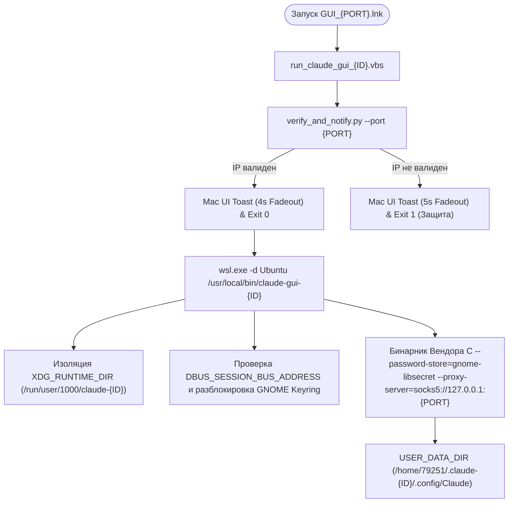
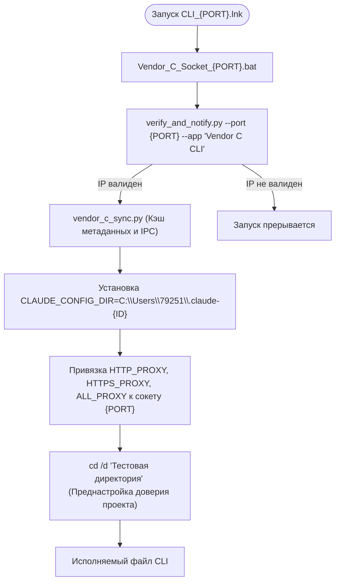

# Архитектура изолированных тестовых сред Вендора C (VENDOR_C_ENVIRONMENT_OVERVIEW.md)

> [!NOTE]
> **Исследовательские цели:**
> Данный материал и архитектурные решения подготовлены строго в исследовательских и образовательных целях для изучения механизмов изоляции процессов в Linux (WSL2/WSLg), криптографических подсистем Chromium OSCrypt/GNOME Keyring, диспетчера учетных данных Windows Credential Manager и сетевой маршрутизации приложений через локальные сокеты без взаимного влияния и утечек данных.

Данный документ представляет собой единый архитектурный и практический путеводитель по созданию, изоляции, сетевой маршрутизации и обслуживанию независимых тестовых экземпляров **GUI-приложения Вендора C (Linux / WSLg)** и **CLI-утилиты Вендора C (Windows)** в инфраструктуре `vless2socks`.

---

## 1. Карта навигации: Что читать и зачем?

| Ресурс / Файл | Назначение | Когда и зачем читать |
|---|---|---|
| [`claude-wsl-gui-manager` (Скилл)](file:///C:/Users/79251/.gemini/config/skills/claude-wsl-gui-manager/SKILL.md) | Главный скилл агента по изоляции сред Вендора C | **Основной источник правды.** Читать при добавлении новых изолированных тестовых профилей, исследовании архитектуры разделения сред, переносе данных и отладке связки ключей GNOME Keyring. |
| [`proxy-launcher-generator` (Скилл)](file:///C:/Users/79251/.gemini/config/skills/proxy-launcher-generator/SKILL.md) | Стандарт создания ярлыков, bat-файлов и иконок | Читать для изучения правил генерации ярлыков Windows, структуры каталога `C:\MyFiles\Proxy` (`ico`, `ink`, `bat`), генерации multi-res `.ico` и кодировок UTF-8 BOM. |
| [`wsl-gui-troubleshooting` (Скилл)](file:///C:/Users/79251/.gemini/config/skills/wsl-gui-troubleshooting/SKILL.md) | Руководство по отладке Linux GUI в WSLg | Читать при исследовании оконных циклов Electron, коллизий блокировок `SingletonLock` и интеграции с `xdotool`. |
| [`VENDOR_C_WSL_GUI_ENVIRONMENTS.md`](file:///C:/MyFiles/vless2socks/VENDOR_C_WSL_GUI_ENVIRONMENTS.md) | Руководство по GUI-приложению Вендора C в WSL2 | Читать для детального изучения Linux-составляющей: переменные окружения, сокеты вспомогательных демонов, шина DBus, Secret Service и флаги Chromium. |
| [`VENDOR_C_CLI_ENVIRONMENTS.md`](file:///C:/MyFiles/vless2socks/VENDOR_C_CLI_ENVIRONMENTS.md) | Руководство по CLI-утилите Вендора C на Windows | Читать для изучения Windows-составляющей: переменная `CLAUDE_CONFIG_DIR`, диспетчер учетных данных Windows и автоматизация trust-диалогов. |
| [`new_claude/README.md`](file:///C:/MyFiles/vless2socks/new_claude/README.md) | Инструкция к набору автоматических скриптов | Читать для получения быстрых команд запуска генераторов инстансов, описания параметров и соответствия цветовых схем портам. |
| [`new_claude/howToCreate.md`](file:///C:/MyFiles/vless2socks/new_claude/howToCreate.md) | Пошаговый путеводитель по созданию инстансов | Практический пошаговый гайдлайн с командами генерации, архитектурным разбором и каталогом скриптов. |

---

## 2. Архитектура изоляции рабочих инстансов (Under the Hood)

В исследовательских целях инфраструктура разделена на две полностью автономные, изолированные среды:

### 2.1. GUI-приложение Вендора C (Linux / WSLg)



#### Принципы изоляции GUI:
1. **Дисковое пространство (Zero Shared State):**
   - Каждому инстансу назначается собственный изолированный каталог `HOME="/home/79251/.claude-<id>"` и `USER_DATA_DIR="$HOME/.config/Claude"`.
   - Внутри размещаются независимые базы данных SQLite, IndexedDB, сессионные куки и конфигурационный файл `config.json`.
   - Это гарантирует полную независимость профилей и предотвращает блокировку параллельных окон файлом `SingletonLock`.
2. **Изоляция вспомогательных сокетов:**
   - Переменная `XDG_RUNTIME_DIR="/run/user/1000/claude-<id>"` направляет файловые сокеты `claude-cowork-vm.sock` и локальные PID-файлы в изолированную директорию, исключая коллизии между параллельными процессами.
3. **Криптографическая подсистема GNOME Keyring (Secret Service):**
   - Для работы системного шифрования Electron API `safeStorage.isEncryptionAvailable()` Chromium требует доступ к сервису `org.freedesktop.secrets`.
   - Инстансы связываются с общей сессионной шиной `DBUS_SESSION_BUS_ADDRESS="unix:path=/run/user/1000/bus"`.
   - Лаунчер автоматически инициирует и разблокирует беспарольный брелок `login.keyring` (`lock-on-idle=false`, `lock-after=false`).
   - Флаг `--password-store=gnome-libsecret` активирует штатное аппаратное/системное шифрование токенов вместо открытого текста (`basic_text`), устраняя системные предупреждения о сохранении сессии.
4. **Контроль оконных процессов:**
   - Проверка активного окна выполняется через `xdotool search --onlyvisible --pid "$MAIN_PID"`. Если окно уже открыто — вызывается `windowactivate`.
   - Фоновый процесс отслеживает закрытие окна и завершает только процессы соответствующего инстанса, не затрагивая соседние тестовые среды.

---

### 2.2. CLI-утилита Вендора C (Windows Host)



#### Принципы изоляции CLI:
1. **Каталог конфигурации `CLAUDE_CONFIG_DIR`:**
   - Для каждого профиля выделяется отдельная папка: `C:\Users\79251\.claude-secondary\`, `C:\Users\79251\.claude-3\` и т.д.
   - В каталоге автономно хранятся история команд `history.jsonl`, сессии, списки проектов и локальные настройки.
2. **Изоляция в Windows Credential Manager:**
   - CLI-утилита формирует уникальный SHA-256 хеш от пути к каталогу `CLAUDE_CONFIG_DIR` и сохраняет учетные данные в диспетчере Windows под изолированным ключом.
3. **Автоматизация тестовых рабочих пространств:**
   - В файл конфигурации профиля предзаполняется доверительный маркер `"hasTrustDialogAccepted": true` для рабочей директории (например, `C:\Users\79251\Downloads\Claude_maclaren`), что обеспечивает бесшовный запуск автоматизированных сценариев.

---

### 2.3. Сетевая верификация и Mac UI Уведомления (`verify_and_notify.py`)

Перед запуском вторичных тестовых сред выполняется предварительная диагностика:
1. **Сетевой аудит маршрута:** Скрипт запрашивает внешний IP через локальный SOCKS5-сокет (`127.0.0.1:<port>`) и сверяет его с параметрами ноды в `instances.json`.
2. **Защита от утечки в базовый шлюз:** Если порт сокета недоступен или трафик направляется через системный шлюз по умолчанию, выполнение прерывается с кодом `1`.
3. **Информационное всплывающее окно в стиле macOS UI:**
   - Располагается в нижнем правом углу экрана.
   - Оформление: macOS Dark Mode (`#1e1e24`), системный шрифт Segoe UI Variable, скругленный контур, бейдж `GUI vless2socks`.
   - **Успешный аудит:** Занимает ~0.3-0.5 секунды. Окно плавно появляется и отображается **4.0 секунды** (fadeout в фоне). Лаунчер мгновенно получает код `0`, и среда запускается **без задержек**.
   - **Сбой аудита:** Отображает красный индикатор несоответствия IP в течение **5.0 секунд**, после чего завершается с кодом `1` — запуск среды блокируется.

---

### 2.4. Интеграция с карточками SystemProxy во vless2socks GUI

В режиме **«Обзор»** (`Overview`) интерфейса `vless2socks` карточки системных прокси сопоставляются с рабочими профилями:
1. **Нумерация профилей:**
   - **Профиль 1** ──► Порт `1015` (`C:\Users\79251\.claude.json`)
   - **Профиль 2** ──► Порт `1016` (`C:\Users\79251\.claude-secondary\.claude.json`)
   - **Профиль N** ──► Порт `1015 + (N - 1)` (`C:\Users\79251\.claude-N\.claude.json`)
2. **Индикация в карточке ноды:**
   - Желтый бейдж: `⚙️ System_Proxy ({N} профиль)`.
   - Персиковый бейдж: `👤 {идентификатор}` (при наличии активной сессии) или серый `👤 Не авторизован`.
   - Информационная строка портов: `SOCKS5: 127.0.0.1:{port} | Vendor C [{N}]: {status}`.
3. **Синхронизация в реальном времени:**
   - При старте CLI скрипт [`vendor_c_sync.py`](file:///C:/MyFiles/vless2socks/vendor_c_sync.py) считывает метаданные, кэширует в [`vendor_c_accounts.json`](file:///C:/MyFiles/vless2socks/vendor_c_accounts.json) и по IPC обновляет бейджи в окне vless2socks на лету.

---

## 3. Каталог исследовательских скриптов в [`new_claude/`](file:///C:/MyFiles/vless2socks/new_claude/)

- [`add_vendor_c_gui_instance.py`](file:///C:/MyFiles/vless2socks/new_claude/add_vendor_c_gui_instance.py) (алиас: `add_claude_gui_instance.py`) — Мастер развертывания нового GUI-инстанса в WSLg за 1 команду (профиль, keyring, шелл-лаунчер, VBS, иконка, ярлык `GUI_{PORT}.lnk`).
- [`add_vendor_c_cli_instance.py`](file:///C:/MyFiles/vless2socks/new_claude/add_vendor_c_cli_instance.py) (алиас: `add_claude_cli_instance.py`) — Мастер развертывания нового CLI-инстанса на Windows (профиль, батник с предстартовой проверкой, иконка, ярлык `CLI_{PORT}.lnk`).
- [`init_wsl_keyring.sh`](file:///C:/MyFiles/vless2socks/new_claude/init_wsl_keyring.sh) (в WSL: `/usr/local/bin/init-wsl-keyring.sh`) — Идемпотентный скрипт инициализации связки ключей GNOME Keyring.
- [`template_claude_gui.sh`](file:///C:/MyFiles/vless2socks/new_claude/template_claude_gui.sh) — Шаблон шелл-лаунчера в `/usr/local/bin/claude-gui-{ID}` с PID-контролем, DBus и флагом `--password-store=gnome-libsecret`.
- [`template_run_gui.vbs`](file:///C:/MyFiles/vless2socks/new_claude/template_run_gui.vbs) — Шаблон бесшумного VBS-скрипта запуска без появления консольных окон.
- [`create_desktop_shortcut.ps1`](file:///C:/MyFiles/vless2socks/new_claude/create_desktop_shortcut.ps1) — PowerShell-скрипт создания ярлыков `.lnk` с UTF-8 BOM и многослойными иконками.
- [`verify_and_notify.py`](file:///C:/MyFiles/vless2socks/new_claude/verify_and_notify.py) — Модуль проверки IP и рендерер Mac UI уведомления.
- [`verify_dual_socket_routing.py`](file:///C:/MyFiles/vless2socks/new_claude/verify_dual_socket_routing.py) — Диагностическая утилита проверки разделения сетевых маршрутов на сокетах 1015 и 1016.

---

## 4. Реестр выполненных изменений

1. **Сетевая изоляция WSL:** Сохранен базовый сетевой профиль WSL [`/etc/profile.d/herdr_claude_env.sh`](file:///etc/profile.d/herdr_claude_env.sh) на сокете **1015**. Вторичные инстансы переведены на локальный оверрайд переменных окружения и флаг `--proxy-server="socks5://127.0.0.1:<port>"`.
2. **Изоляция оконных процессов:** Устранен конфликт завершения чужих процессов — внедрен контроль окон через `xdotool`. Сокеты виртуальной машины изолированы через `XDG_RUNTIME_DIR="/run/user/1000/claude-<id>"`.
3. **Интеграция с GNOME Keyring:** Отключен флаг `--password-store=basic`. Настроен автозапуск `gnome-keyring-daemon` с беспарольным `login.keyring` на `/run/user/1000/bus`. Добавлено гарантированное создание каталога в [`/usr/local/bin/herdr_boot_isolation.sh`](file:///usr/local/bin/herdr_boot_isolation.sh).
4. **Сетевой аудит маршрута:** Внедрен предстартовый модуль `verify_and_notify.py` со сглаженным Mac UI уведомлением.
5. **Интерфейс vless2socks:** Добавлена индикация статуса тестовых профилей на вкладке «Обзор» с автосинхронизацией по IPC.
6. **Настройка тестовых каталогов CLI:** Профиль 2 настроен на работу с изолированной директорией `C:\Users\79251\Downloads\Claude_maclaren` с преднастройкой trust-диалога.
7. **Стандартизация ярлыков:** Установлен формат имен `GUI_{PORT}.lnk` и `CLI_{PORT}.lnk` с цветовой индикацией портов.

---

## 5. Практическое руководство: Создание нового профиля за 1 команду

С опорой на скилл [`claude-wsl-gui-manager`](file:///C:/Users/79251/.gemini/config/skills/claude-wsl-gui-manager/SKILL.md) развертывание выполняется одной командой:

### Создание GUI инстанса (например, Инстанс 3, порт 1020, фиолетовый):
```cmd
python C:\MyFiles\vless2socks\new_claude\add_vendor_c_gui_instance.py --id 3 --port 1020 --color purple
```
**Результат:**
1. На Рабочем столе появится ярлык `GUI_1020.lnk`.
2. В WSL сгенерируется лаунчер `/usr/local/bin/claude-gui-3`.
3. Брелок `login.keyring` подготовится в `/home/79251/.claude-3/.local/share/keyrings/`.
4. При клике пройдет аудит IP с Mac UI тостом, откроется GUI, и сессия сохранится в связке ключей.

### Создание CLI инстанса (тот же сокет 1020):
```cmd
python C:\MyFiles\vless2socks\new_claude\add_vendor_c_cli_instance.py --id 3 --port 1020 --color purple
```
**Результат:**
1. На Рабочем столе появится ярлык `CLI_1020.lnk`.
2. Создастся батник `C:\MyFiles\Proxy\Vendor_C_Socket_1020.bat`.
3. Создастся изолированный профиль `C:\Users\79251\.claude-3\`.
4. Сессия привяжется к сокету 1020 с передачей статуса в GUI vless2socks.
