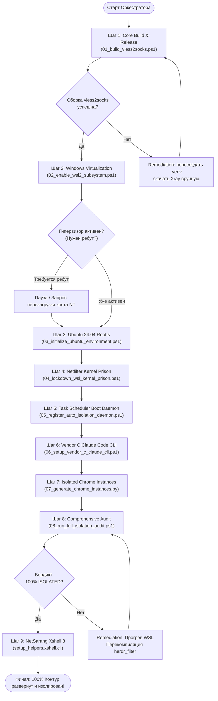

# Руководство Оркестратора Субагентов: Автономное развертывание и изоляция контура vless2socks

Данный документ описывает протокол работы мастер-оркестратора (ведущей модели или супервизора агентов) для пошагового управления субагентами при развертывании, сетевой изоляции и тестировании всего стека **vless2socks**.

Машиночитаемая спецификация последовательности шагов оформлена в файле:  
👉 [`workflow_sequence.json`](./workflow_sequence.json) (копия в [`skills/initial_start/workflow_sequence.json`](skills/initial_start/workflow_sequence.json)).

---

## 1. Концепция Оркестратора и Роли Субагентов

Оркестратор работает по принципу **Strict Step-by-Step Enforcement** (жесткое последовательное выполнение с обязательной верификацией):
1. Оркестратор считывает очередной шаг из `workflow_sequence.json`.
2. Проверяет выполнение `preconditions`.
3. Поднимает специализированного субагента с заданной ролью и передает ему нормализованный промпт (`normalized_task_prompt`).
4. Субагент вызывает соответствующий скрипт из [`setup_helpers/`](setup_helpers/) или выполняет требуемые манипуляции.
5. Оркестратор запускает `verification_command` и сверяет результат с `expected_output_pattern`.
6. Только при 100% совпадении оркестратор фиксирует этап и переходит к следующему шагу. При сбое активируется блок `remediation_action`.

### Ролевая модель субагентов:

| Шаг | Роль субагента | Зона ответственности | Скрипт-раннер |
| :--- | :--- | :--- | :--- |
| **01** | `Core Build & Release Engineer` | Клонирование Git, venv, зависимости, скачивание Xray, PyInstaller сборка, NTFS Junction. | [`01_build_vless2socks.ps1`](setup_helpers/01_build_vless2socks.ps1) |
| **02** | `Windows Kernel & Virtualization Specialist` | DISM активация WSL2/VirtualMachinePlatform, BCD, `.wslconfig` (mirrored mode). | [`02_enable_wsl2_subsystem.ps1`](setup_helpers/02_enable_wsl2_subsystem.ps1) |
| **03** | `Linux System Administrator` | Инициализация корня `ubuntu2404 install --root`, неинтерактивный `apt` (nftables, iptables, curl). | [`03_initialize_ubuntu_environment.ps1`](setup_helpers/03_initialize_ubuntu_environment.ps1) |
| **04** | `Netfilter & Network Prison Hardener` | Компиляция netfilter `herdr_filter`, `socks5h` Remote DNS, `/etc/wsl.conf` автозагрузка. | [`04_lockdown_wsl_kernel_prison.ps1`](setup_helpers/04_lockdown_wsl_kernel_prison.ps1) |
| **05** | `Windows Automation & Task Scheduler Engineer` | Регистрация задачи `WSL_AutoIsolation_Guard`, мультилокальный парсинг русского вывода WSL. | [`05_register_auto_isolation_daemon.ps1`](setup_helpers/05_register_auto_isolation_daemon.ps1) |
| **06** | `CLI Process Isolation & Security Specialist` | Развертывание Claude Code CLI, Killswitch `verify_and_notify.py`, разделение токенов в Credential Manager. | [`06_setup_vendor_c_claude_cli.ps1`](setup_helpers/06_setup_vendor_c_claude_cli.ps1) |
| **07** | `Browser Isolation & GUI Asset Engineer` | Извлечение ICO из `chrome.exe` через `pefile`, HSV перекраска, батники с `--user-data-dir`, симлинки `link/lnk`. | [`07_generate_chrome_instances.py`](setup_helpers/07_generate_chrome_instances.py) |
| **08** | `Perimeter Security & Penetration Audit Specialist` | Комплексный стресс-тест сетевого контура, проверка утечек Direct IP и вердикт `100% ISOLATED`. | [`08_run_full_isolation_audit.ps1`](setup_helpers/08_run_full_isolation_audit.ps1) |
| **09** | `Enterprise Terminal Integration & Cryptography Engineer` | Развертывание NetSarang Xshell 8, решение ошибки 40004 в `nslicense.dll`, UTF-16 LE SOCKS5 INI, ARC4 шифрование сессий. | [`setup_xshell.bat`](setup_helpers/setup_xshell.bat) & `setup_helpers.xshell` |

---

## 2. Граф выполнения Оркестратора



---

## 3. Мастер-команды для запуска

### Вариант А: Запуск единого конвейера целиком через PowerShell
```powershell
powershell -NoProfile -ExecutionPolicy Bypass -File "C:\proj\vless2socks\install_all.ps1"
```

### Вариант Б: Автоматический парсинг через Python Оркестратор
```python
import json
import subprocess

with open(r"C:\proj\vless2socks\workflow_sequence.json", "r", encoding="utf-8") as f:
    wf = json.load(f)

for step in wf["execution_sequence"]:
    print(f"\n[ORCHESTRATOR] Запуск {step['step_id']} ({step['subagent_role']})...")
    print(f"  Промпт: {step['normalized_task_prompt']}")
    
    # Исполнение команды
    rc = subprocess.run(step["command_line"], shell=True)
    if rc.returncode != 0:
        print(f"  [ОШИБКА] Шаг {step['step_id']} вернул код {rc.returncode}")
        print(f"  Действие по исправлению: {step['remediation_action']}")
        break
    
    # Верификация
    chk = subprocess.run(step["verification_command"], shell=True, capture_output=True, text=True)
    print(f"  [OK] Верификация пройдена успешно.")
```

---

## 4. Ссылки на спецификации и документацию
- **Главный скилл первоначальной сборки:** [`skills/initial_start/SKILL.md`](skills/initial_start/SKILL.md) / [`initial_start.md`](initial_start.md)
- **Скилл развертывания NetSarang Xshell 8:** [`skills/xshell/SKILL.md`](skills/xshell/SKILL.md)
- **Стенограмма чата (XML):** [`skills/initial_start/chat_reference.xml`](skills/initial_start/chat_reference.xml)
- **Стенограмма сессии Xshell (XML):** [`skills/xshell/chat_history.xml`](skills/xshell/chat_history.xml)
- **Каталог вспомогательных скриптов:** [`setup_helpers/`](setup_helpers/)
- **Пакет автоматизации Xshell:** [`setup_helpers/xshell/`](setup_helpers/xshell/)
