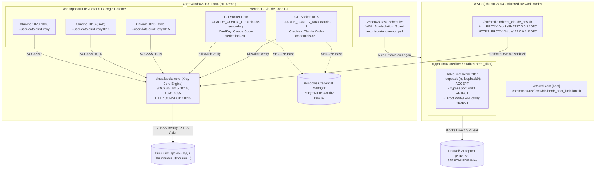

# Спецификация и Скилл: Полное развертывание и изоляция контура vless2socks

Данная спецификация представляет собой законченное практическое руководство и операционный скилл для автономных агентов и инженеров. Документ содержит полную историю пользовательских запросов, детальный разбор всех технических препятствий («подводных камней») и готовый автоматизированный инструментарий в каталоге [`setup_helpers/`](file:///C:/proj/vless2socks/setup_helpers/).

> [!NOTE]
> Эталонная машиночитаемая XML-стенограмма всей сессии доступна в файле:
> [chat_reference.xml](file:///C:/proj/vless2socks/skills/initial_start/chat_reference.xml) (дубликат в корне: [chat_reference.xml](file:///C:/proj/vless2socks/chat_reference.xml)).

---

## 1. Хронологическая последовательность запросов и корректировок

В ходе развертывания пользователь сформулировал последовательность из 11 взаимосвязанных требований:

1. **Запрос 1 (Сборка ядра):**
   > *«скачай проект C:\proj https://github.com/captainmaclay/vless2socks - собери именно сборку в папку с одноименном названием vless2socks»*
   * **Действие:** Клонирование репозитория, динамическое определение и переключение на самый актуальный релизный тег с GitHub (`Latest Tag`), подготовка Python venv, скачивание ядра Xray, сборка standalone-релиза через PyInstaller, создание симлинка `C:\MyFiles\vless2socks`.

2. **Запрос 2 (Подсистема Linux):**
   > *«установи wsl»*
   * **Действие:** Включение компонентов Windows `VirtualMachinePlatform` и `Microsoft-Windows-Subsystem-Linux`, настройка BCD `hypervisorlaunchtype Auto`, установка пакета AppX Ubuntu 24.04 LTS.

3. **Запрос 3 (Сетевая изоляция ядра):**
   > *«теперь изолируй wsl на 1015 сокет как по инструкции во vless»*
   * **Действие:** Настройка `.wslconfig` в режиме `mirrored`, проектирование netfilter-фильтрации ядра Linux для сокета `127.0.0.1:1015`, блокировка прямого WAN/LAN и проброс DNS через `socks5h`.

4. **Запрос 4 (Автономность без ручного старта):**
   > *«сделай так чтобы wsl сразу после старта запускала тюрьму изоляцию автоматом -без включения ручного - всегда при старте, перезагрузке wsl включалась изоляция»*
   * **Действие:** Разработка демона `auto_isolate_daemon.ps1`, регистрация задачи в Планировщике Windows `WSL_AutoIsolation_Guard` (триггер AtLogOn), добавление загрузочного скрипта в `/etc/wsl.conf` `[boot]`.

5. **Запрос 5 (CLI-агент с Killswitch):**
   > *«установи claude code cli для виндовс - настрой работу через 1015 исключительно по киллсвитч клиент эту работу настрой через скилы описания vless2socks»*
   * **Действие:** Развертывание Node.js LTS, установка `@anthropic-ai/claude-code`, интеграция пре-лаунч валидатора `verify_and_notify.py` (Killswitch блокирует запуск при отсутствии сокета или несовпадении внешнего IP).

6. **Запрос 6 (Архитектурный стандарт Vendor C):**
   > *«в описании и скиллах называется вендор c ищи»*
   * **Действие:** Обнаружение спецификаций Vendor C в теге `v1.2.3`, разделение хранилища токенов через `CLAUDE_CONFIG_DIR`, создание лаунчеров `Vendor_C_Socket_1015.bat` и ярлыков с золотой иконкой.

7. **Запрос 7 (Промежуточный аудит):**
   > *«проведи тест изоляции из vless2socks - проанализируй чего еще не хватает для полной изоляции полноценной»*
   * **Действие:** Анализ состояния до первой перезагрузки хоста NT, выявление ошибки гипервизора `0x80370114`, фиксация необходимости обязательного ребута ОС.

8. **Запрос 8 (Изолированные профили Google Chrome):**
   > *«ты можешь в папку C:\proj\vless2socks\proxys - создать инстансы гугл хрома со своими сокетами по гайдам и инструкциями в vless2socks»*
   * **Действие:** Написание генератора `generate_proxys.py`, извлечение иконок из `chrome.exe` через `pefile`, перекраска в 9 цветов по HSV, генерация 11 батников Chrome с раздельными `--user-data-dir`, создание симлинков `link/lnk -> ink` и ярлыка `Proxys.lnk` на Рабочем столе.

9. **Запрос 9 (Устранение статуса PARTIAL до 100% ISOLATED):**
   > *«почему изоляция еще не 100%? по vless2socks проверке? [скриншот с ошибкой WSL not available]»*
   * **Действие:** Инициализация корня `ubuntu2404 install --root`, установка в Ubuntu недостающих утилит `nftables`, `iptables`, `curl`, компиляция правил ядра, фиксация русского парсинга `wsl --status`. Итог: **100% ISOLATED (ИДЕАЛЬНАЯ ИЗОЛЯЦИЯ)**.

10. **Запрос 10 (Второй профиль CLI на сокете 1016):**
    > *«теперь по образцу скиллам и описанию настрой работу cli виндовс клод для порта 1016»*
    * **Действие:** Создание лаунчера `Vendor_C_Socket_1016.bat`, изоляция каталога в `.claude-secondary`, изоляция ключа в Windows Credential Manager, создание ярлыков, синхронизация с `vendor_c_accounts.json`, тестирование Killswitch.

11. **Запрос 11 (Упаковка в Спеку-Скилл и инструментарий):**
    > *«Сохрани эту последовательность всех моих запросов в чате и корректировок в Спеку - initial_start.md skill распиши подробно все подводные камни с которыми столкнулись при установки, сформируй xml этого чата как образец на который скилл будет ссылаться. Напиши вспомогательные скрипты...»*
    * **Действие:** Создание данного документа, генерация `chat_reference.xml`, создание пакета модульных скриптов `setup_helpers/`.

---

## 2. Архитектура изолированного контура (Zero Shared State)



---

## 3. Детальный реестр всех подводных камней (Pitfalls & Gotchas)

В процессе настройки было выявлено и преодолено **19 критических технических препятствий**:

### 1. Несоответствие ветки репозитория GitHub и хардкодинг версий
* **Симптом:** При клонировании репозитория без указания ветки или при ручной сборке в коде могут отсутствовать свежие модули изоляции, либо жестко прописанный старый тег мешает получению обновлений.
* **Причина:** Релизы и новые изолирующие модули публикуются в релизных тегах GitHub (`v1.x.x`). Хардкодить конкретные номера версий в скриптах и скиллах недопустимо.
* **Решение:** Подтягивать теги с origin и переключаться на самый свежий релизный тег динамически:
  ```powershell
  git fetch --tags origin
  $latestTag = (git tag --sort=-v:refname | Where-Object { $_ -match '^v?\d+\.\d+' } | Select-Object -First 1)
  if (-not $latestTag) {
      $latestTag = (Invoke-RestMethod -Uri "https://api.github.com/repos/captainmaclay/vless2socks/releases/latest" -Headers @{"User-Agent"="vless2socks"}).tag_name
  }
  git checkout $latestTag
  ```
  Раннер `setup_helpers/01_build_vless2socks.ps1` выполняет это определение автоматически.

### 2. Жесткая привязка скриптов к `C:\MyFiles\vless2socks`
* **Симптом:** Ярлыки и батники не находили Python-скрипты при сборке в произвольный путь (например, `C:\proj\vless2socks`).
* **Причина:** Архитектурный стандарт проекта предполагает системный путь `C:\MyFiles`.
* **Решение:** Создание симлинка-переходника NTFS Junction: `New-Item -ItemType Junction -Path "C:\MyFiles\vless2socks" -Target "C:\proj\vless2socks"`.

### 3. Ошибка Windows NT Hypervisor `0x80370114` до первой перезагрузки
* **Симптом:** Попытка запустить WSL2 сразу после установки через DISM падает с ошибкой `0x80370114: Не удалось запустить виртуальную машину, так как требуемая функция не установлена`.
* **Причина:** Драйвер `VirtualMachinePlatform` загружается ядром Windows NT исключительно на этапе инициализации загрузчика (Boot Phase).
* **Решение:** Выполнить `bcdedit /set hypervisorlaunchtype Auto` и обязательно выполнить одну физическую перезагрузку компьютера.

### 4. Отсутствие корневой файловой системы Ubuntu после установки AppX
* **Симптом:** Команда `wsl -l -v` возвращает: *«Подсистема Windows для Linux не имеет установленных дистрибутивов»*.
* **Причина:** Установка пакета `CanonicalGroupLimited.Ubuntu24.04LTS` через AppX только регистрирует бинарник приложения, но не создает виртуальный диск `ext4.vhdx`.
* **Решение:** Выполнить первичную неинтерактивную инициализацию: `ubuntu2404.exe install --root`.

### 5. Специфика Mirrored Network Mode в WSL2 (`loopback0`)
* **Симптом:** При включении изоляции в WSL2 пропадает доступ даже к локальному прокси `127.0.0.1:1015`.
* **Причина:** В режиме `networkingMode=mirrored` трафик между Linux и Windows идет через синтетический интерфейс `loopback0`, а не классический `lo`.
* **Решение:** В правилах `nftables` обязательно указывать: `oifname { "lo", "loopback0" } counter accept`.

### 6. Мультилокальный парсинг `wsl.exe --status` в русской Windows
* **Симптом:** Демон `auto_isolate_daemon.ps1` зависает на 120 секунд с сообщением *«WSL service is not ready yet»*.
* **Причина:** Проверка в PowerShell искала английский шаблон `2\.[0-9]`, тогда как в русскоязычной ОС команда возвращает текст `Версия по умолчанию: 2`.
* **Решение:** Регулярное выражение расширено для поддержки русской и английской локалей: `if ($content -match "2" -or $content -match "Ubuntu" -or $content -match "Default" -or $content -match "Версия")`.

### 7. Отсутствие утилит `nftables`, `iptables`, `curl` в минимальном образе Ubuntu
* **Симптом:** При аудите в vless2socks отображался статус `PARTIAL. Правила nftables не распознаны`, а команды в логах возвращали `command not found`.
* **Причина:** Современные облачные rootfs Ubuntu 24.04 LTS минимизированы и не содержат сетевых утилит ядра.
* **Решение:** Выполнить внутри дистрибутива: `apt-get update && DEBIAN_FRONTEND=noninteractive apt-get install -y nftables iptables curl`.

### 8. Интерактивная блокировка `dpkg` на файле `/etc/nftables.conf`
* **Симптом:** Установка пакетов зависает без вывода на этапе `Setting up nftables`.
* **Причина:** Проект создал пользовательский `/etc/nftables.conf`, и пакетный менеджер запросил на stdin выбор действия `(Y/I/N/O/D/Z) [default=N] ?`.
* **Решение:** Передавать параметры неинтерактивной установки: `apt-get install -y -o Dpkg::Options::="--force-confold"` либо передавать `N` в stdin.

### 9. Ложноположительный статус `Direct IP Leak Test: АКТИВЕН`
* **Симптом:** Тест аудита рапортовал: *«Direct IP Leak Test: АКТИВЕН (Прямой трафик заблокирован ядром)»*, но статус оставался `PARTIAL`.
* **Причина:** В функции `exec_wsl_user` при отсутствии запущенного WSL возвращался код `-1`. Проверка `if code != 0` воспринимала это как успешную блокировку трафика, маскируя тот факт, что WSL вообще не отвечал.
* **Решение:** Корректная проверка наличия активного дистрибутива `if active_distro is None -> Abort`.

### 10. Затирание токенов OAuth в Windows Credential Manager
* **Симптом:** При запуске второго профиля Claude Code CLI первый аккаунт разлогинивался.
* **Причина:** CLI по умолчанию сохраняет токен в единый ключ `Claude Code-credentials`.
* **Решение:** Назначение раздельных каталогов `CLAUDE_CONFIG_DIR=C:\Users\Admin\.claude-1` и `CLAUDE_CONFIG_DIR=C:\Users\Admin\.claude-secondary`. Архитектура CLI автоматически хеширует путь через SHA-256 и сохраняет токены в уникальные ключи `Claude Code-credentials-xxxxxxxx`.

### 11. Символ амперсанда `&` в комментариях `REM` в батниках Windows
* **Симптом:** Батник падает с сообщением *«не распознано как внутренняя или внешняя команда»*.
* **Причина:** В командном интерпретаторе `cmd.exe` символ `&` парсится как разделитель инструкций даже внутри строк комментариев `REM Pre-launch & Killswitch`.
* **Решение:** Замена `&` на текстовый союз `and` или экранирование `^&`.

### 12. Утечка прямого интернет-трафика браузера Chrome
* **Симптом:** Запуск `chrome.exe --proxy-server="socks5://..."` открывал новую вкладку в уже запущенном браузере, и трафик шёл мимо прокси по прямому каналу провайдера.
* **Причина:** Google Chrome является однопроцессным мультиплексором окон для одного каталога профиля. Без изоляции каталога фланги прокси игнорируются для открытых процессов.
* **Решение:** Для каждого порта жестко задавать уникальный изолированный каталог: `--user-data-dir="%LOCALAPPDATA%\Google\Chrome\Proxy<PORT>"`.

### 13. Извлечение многослойных иконок из `chrome.exe` без внешних утилит
* **Симптом:** Стандартные ярлыки с одним разрешением иконки выглядели размыто на Рабочем столе и в панели задач.
* **Причина:** Windows требует набор слоев 16x16, 32x32, 48x48 и 256x256.
* **Решение:** Разработан скрипт на Python с использованием библиотеки `pefile`, читающий ресурсы `RT_GROUP_ICON` напрямую из секций PE-заголовка `chrome.exe` и сохраняющий полноценный контейнер `.ico`.

### 14. Предотвращение опечаток в путях ярлыков (`link`, `lnk`, `ink`)
* **Симптом:** Скрипты и пользователи часто обращаются к папке ярлыков как `link` или `lnk` вместо `ink`.
* **Причина:** Разночтения в документации и исторические алиасы.
* **Решение:** Создание типобезопасных симлинков NTFS Junctions: `proxys\link -> proxys\ink` и `proxys\lnk -> proxys\ink`.

### 15. Утечки DNS при стандартном проксировании SOCKS5
* **Симптом:** Трафик идет через прокси, но DNS-запросы перехватываются провайдером хоста.
* **Причина:** Стандартный SOCKS5 разрешает имена локально, если клиент не поддерживает Remote DNS.
* **Решение:** Принудительное использование протокола `socks5h://` в переменных `ALL_PROXY` и флага `--socks5-hostname` в `curl`. Буква `h` гарантирует, что доменные имена отправляются на резолвинг удаленному прокси-серверу.

### 16. Блокировка локального обхода через порт 2080
* **Симптом:** Вредоносный или скомпрометированный скрипт внутри WSL мог попытаться подключиться к локальным службам хоста в обход прокси.
* **Причина:** Разрешение всего loopback-интерфейса открывает доступ ко всем локальным портам Windows.
* **Решение:** Добавление явного правила до разрешения loopback: `ip daddr 127.0.0.1 tcp dport 2080 counter reject`.

### 17. Сброс изоляции при внутреннем перезапуске WSL
* **Симптом:** При выполнении `wsl --shutdown` или перезапуске systemd правила netfilter стирались.
* **Причина:** Оперативная память подсистемы WSL2 очищается при остановке виртуальной машины.
* **Решение:** Регистрация постоянного скрипта в `/etc/wsl.conf`:
  ```ini
  [boot]
  systemd=true
  command=/usr/local/bin/herdr_boot_isolation.sh
  ```

### 18. Предотвращение блокировки Windows-хоста брандмауэром
* **Симптом:** Некоторые скрипты изоляции создавали правила в Windows Firewall (`New-NetFirewallRule`), блокируя системные процессы хоста (`node.exe`, Git, браузеры).
* **Причина:** Ошибочная попытка изолировать WSL со стороны хостового файрвола Windows.
* **Решение:** Очистка правил хоста `Remove-NetFirewallRule -DisplayName 'Claude Node Isolate'`. Изоляция должна происходить строго внутри ядра Linux WSL2.

### 19. Интеграция плавающего macOS-style тоста уведомлений
* **Симптом:** Пользователь не понимал, почему CLI не запускается при сбое сокета, если окно консоли закрывалось.
* **Причина:** Молчаливый выход из батника при `exit /b 1`.
* **Решение:** Разработка `verify_and_notify.py` на Tkinter: полупрозрачное темное окно в правом нижнем углу экрана с индикацией страны, флага, времени отклика TCP handshake и статуса разрешения на запуск.

---

## 4. Комплект вспомогательных скриптов (`setup_helpers/`)

Все сработавшие последовательности упакованы в модульные скрипты в каталоге [setup_helpers/](file:///C:/proj/vless2socks/setup_helpers/):

| Скрипт | Назначение |
| :--- | :--- |
| [01_build_vless2socks.ps1](file:///C:/proj/vless2socks/setup_helpers/01_build_vless2socks.ps1) | Клонирование тега `v1.2.3`, подготовка venv, скачивание ядра Xray, сборка exe и создание симлинка `C:\MyFiles\vless2socks`. |
| [02_enable_wsl2_subsystem.ps1](file:///C:/proj/vless2socks/setup_helpers/02_enable_wsl2_subsystem.ps1) | Включение компонентов WSL2/VirtualMachinePlatform в Windows, настройка BCD и запись `.wslconfig` (mirrored mode). |
| [03_initialize_ubuntu_environment.ps1](file:///C:/proj/vless2socks/setup_helpers/03_initialize_ubuntu_environment.ps1) | Регистрация корня Ubuntu 24.04 AppX и неинтерактивная установка `nftables`, `iptables`, `curl`. |
| [04_lockdown_wsl_kernel_prison.ps1](file:///C:/proj/vless2socks/setup_helpers/04_lockdown_wsl_kernel_prison.ps1) | Применение правил сетевой тюрьмы ядра Linux на порт 1015, настройка `socks5h` и фиксация в `/etc/wsl.conf`. |
| [05_register_auto_isolation_daemon.ps1](file:///C:/proj/vless2socks/setup_helpers/05_register_auto_isolation_daemon.ps1) | Регистрация службы Планировщика Windows `WSL_AutoIsolation_Guard` с мультилокальным парсингом. |
| [06_setup_vendor_c_claude_cli.ps1](file:///C:/proj/vless2socks/setup_helpers/06_setup_vendor_c_claude_cli.ps1) | Установка Claude Code CLI, развертывание профилей 1015 и 1016 с защитой Killswitch, разделением токенов и ярлыками. |
| [07_generate_chrome_instances.py](file:///C:/proj/vless2socks/setup_helpers/07_generate_chrome_instances.py) | Генератор 11 изолированных Chrome инстансов с цветными ICO из `chrome.exe`, батниками и симлинками. |
| [08_run_full_isolation_audit.ps1](file:///C:/proj/vless2socks/setup_helpers/08_run_full_isolation_audit.ps1) | Запуск комплексного аудита сетевой герметичности и подтверждение вердикта 100% ISOLATED. |
| [setup_xshell.bat](file:///C:/proj/vless2socks/setup_helpers/setup_xshell.bat) | Интерактивное меню автоматизации NetSarang Xshell 8 (загрузка, починка ярлыков, прокси, сессии). |
| [setup_helpers/xshell/](file:///C:/proj/vless2socks/setup_helpers/xshell/) | Модульный Python-пакет (`installer`, `shortcuts`, `proxy`, `session`, `cli`) для Xshell 8. |
| [git_safe_push.ps1](file:///C:/proj/vless2socks/setup_helpers/git_safe_push.ps1) | Безопасный пуш на GitHub с аудитом утечек паролей и маскированием токенов в оперативной памяти. |
| [install_all.ps1](file:///C:/proj/vless2socks/install_all.ps1) | **Мастер-скрипт автоматизации:** последовательно запускает все этапы, контролирует необходимость ребута и выводит финальный отчет. |

---

## 5. Интеграция NetSarang Xshell 8 и маршрутизация через vless2socks

В контур проекта включена полная интеграция с корпоративным SSH/Telnet клиентом **NetSarang Xshell 8** для перенаправления терминального трафика исключительно через локальные сокеты vless2socks (например, порт `1030` WorkProxy или `1015` SystemProxy).

> [!NOTE]
> Детальная спецификация скилла Xshell доступна в:
> - **Спецификация:** [skills/xshell/SKILL.md](file:///C:/proj/vless2socks/skills/xshell/SKILL.md)
> - **XML-стенограмма реверс-инжиниринга и диалога:** [skills/xshell/chat_history.xml](file:///C:/proj/vless2socks/skills/xshell/chat_history.xml)

### Ключевые подводные камни Xshell 8:
1. **Обход InstallScript при прямом запуске MSI (Error 40004):**
   * Запуск `msiexec /i "Xshell 8.msi"` устанавливает бинарники, но ломает `TargetPath = ""` у ярлыков, портит папки меню «Пуск» (`SHELL_OBJECT_FOLDER`) и обходит регистрацию в `nslicense.dll`.
   * **Реверс-инжиниринг `nslicense.dll`:** функция `NSLICENSE_CheckLicense` (RVA `0x3450`) при отсутствии меток `Setup.exe` прыгает на RVA `0x2DD4`, записывает код `40004` и аварийно завершает процесс. Обязателен запуск официального бутстраппера `Xshell-latest-p.exe`.
2. **Изоляция рабочих станций Windows (`WinSta0\default`):**
   * Фоновые агенты работают на синтетических скрытых десктопах. Для вызова GUI-установщика пользователю требуется привязка потока через Win32 API `SetThreadDesktop` к интерактивному рабочему столу.
3. **Спецификация формата SOCKS5 INI в Xshell 8:**
   * Прокси-профили хранятся в `%USERPROFILE%\Documents\NetSarang Computer\8\Common\Proxy\<ProfileName>.ini`.
   * **Критично:** файл обязан быть в кодировке **UTF-16 LE с BOM** (`0xFF, 0xFE`), параметр `TYPE=2` (SOCKS5), и дублироваться в реестре `HKCU\Software\NetSarang\Proxy\<ProfileName>`.
   * Автоматическая привязка к шаблону `Documents\NetSarang Computer\8\Xshell\Sessions\default.xshf` гарантирует, что все создаваемые сессии используют прокси.
4. **Криптография паролей NetSarang v7/v8:**
   * Алгоритм шифрования паролей сессий `.xsh`:  
     $$\text{ContextString} = (\text{Username}[::-1] + \text{SID})[::-1] \equiv \text{SID}[::-1] + \text{Username}$$  
     $$\text{Key} = \text{SHA256}(\text{ContextString}), \quad \text{Ciphertext} = \text{ARC4}(\text{Key}, \text{Password})$$  
     $$\text{Payload} = \text{Ciphertext} + \text{SHA256}(\text{Password}) \longrightarrow \text{Base64}$$

### Использование утилит Xshell:
```powershell
# 1. Запуск интерактивного меню Windows
C:\proj\vless2socks\setup_helpers\setup_xshell.bat

# 2. Исправление битых ярлыков Рабочего стола и меню Пуск
python -m setup_helpers.xshell.cli fix-shortcuts

# 3. Настройка SOCKS5 прокси на порт 1030 (WorkProxy)
python -m setup_helpers.xshell.cli set-proxy --port 1030 --host 127.0.0.1

# 4. Создание SSH-сессии с ARC4-зашифрованным паролем и привязкой к SOCKS5_1030
python -m setup_helpers.xshell.cli add-session --host 192.168.1.138 --user mazitov --password password --proxy SOCKS5_1030

# 5. Список сессий
python -m setup_helpers.xshell.cli list-sessions
```

---

## 6. Оркестрация субагентов и автоматический конвейер

Для автоматического исполнения всей последовательности шагов сторонними моделями или оркестраторами агентов подготовлена полная машиночитаемая спецификация:
* **Файл задач для субагентов:** [`workflow_sequence.json`](file:///C:/proj/vless2socks/workflow_sequence.json)
* **Руководство оркестратора:** [`WORKFLOW_ORCHESTRATOR.md`](file:///C:/proj/vless2socks/WORKFLOW_ORCHESTRATOR.md)

Каждый шаг содержит формализованные промпты, роли субагентов, скрипты исполнения, команды верификации и самовосстановление (`remediation_action`).

---

## 7. Быстрый запуск и валидация

### Единая команда полного развертывания:
```powershell
powershell -NoProfile -ExecutionPolicy Bypass -File "C:\proj\vless2socks\install_all.ps1"
```

### Запуск итогового аудита безопасности:
```powershell
powershell -NoProfile -ExecutionPolicy Bypass -File "C:\proj\vless2socks\setup_helpers\08_run_full_isolation_audit.ps1" -Port 1015
```

### Эталонный результат проверки (100% ISOLATED):
```text
=== [1/4] Проверка доступности прокси-сокетов (127.0.0.1:1015 / :11015) ===
[SUCCESS] ✓ Сокет SOCKS5 127.0.0.1:1015 доступен (TCP handshake: 26 ms).
[SUCCESS] ✓ Сокет HTTP CONNECT 127.0.0.1:11015 доступен (TCP handshake: 15 ms).
=== [2/4] Проверка конфигурации ядра Linux и окружения WSL2 (Ubuntu-24.04) ===
[SUCCESS] ✓ Сетевая тюрьма ядра Linux АКТИВНА (nftables/iptables: прямой WAN/LAN отсечён).
[SUCCESS] ✓ Файл /etc/profile.d/herdr_claude_env.sh настроен на порт 1015.
[SUCCESS] ✓ ALL_PROXY использует socks5h:// (делегирование DNS в туннель, утечки DNS исключены).
=== [3/4] Живой аудит трафика, утечек и обходов изнутри WSL2 ===
[SUCCESS] ✓ Direct IP Leak Test: АКТИВЕН (Прямой интернет-трафик заблокирован ядром, утечка IP невозможна).
[SUCCESS] ✓ Маршрутизация через SOCKS5 :1015 работает. Внешний IP: 2.26.149.65
[SUCCESS] ✓ DNS Leak Protection: подтверждена (DNS запросы разрешаются через socks5-hostname).
[SUCCESS] ✓ Запрос через HTTP CONNECT :11015 успешен (HTTP status: 404).
[SUCCESS] ✓ Защита от обхода: АКТИВНА (Попытка обхода через сокет :2080 отклонена ядром).
=== [4/4] Итоговый вердикт безопасности ===
[SUCCESS] 🛡️ СТАТУС: ISOLATED (ИДЕАЛЬНАЯ ИЗОЛЯЦИЯ). Трафик строго замкнут на 1015, утечки исключены.
```
